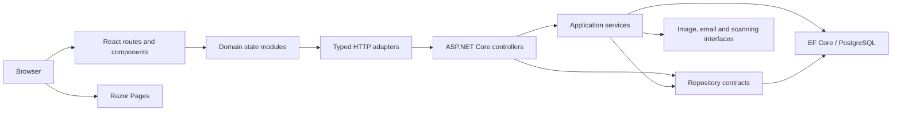
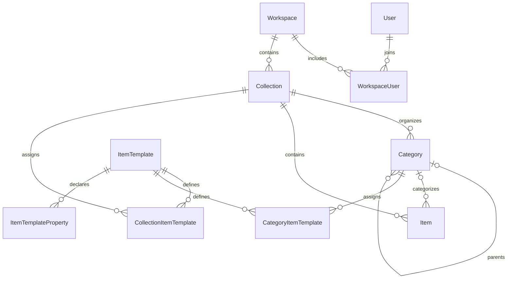

# OneBigHead architecture

OneBigHead is a collection catalog with workspace isolation, hierarchical categories,
custom item properties, images, and explicitly published public galleries. It runs as
a React application backed by an ASP.NET Core API and PostgreSQL. Razor Pages serve
the public landing, authentication, and legal pages.

This document describes the current implementation. The remaining refactor work at
the end identifies boundaries that are still broader than they should be.

## System and deployment boundaries



Development uses Vite on port 5173 and ASP.NET Core on port 5148. Vite proxies API
and Razor requests to the backend. PostgreSQL 17 runs in the local Docker Compose
service. The startup scripts apply migrations and converge the system theme and
template seeds before launching both application processes.

Production packages the built SPA under the backend's `wwwroot/collections`
directory. The backend serves SPA fallbacks only for application route families;
missing API routes and asset files remain HTTP 404s. Production database changes
use an EF migration bundle, rather than application startup migration code.

## Repository map

| Location | Responsibility |
| --- | --- |
| `frontend/src/views` | Route parameters, navigation and page composition |
| `frontend/src/components` | Reusable UI organized by domain and common controls |
| `frontend/src/data` | Domain state, loading and mutation coordination |
| `frontend/src/contexts` | Provider composition and application-level state access |
| `frontend/src/api` | Typed HTTP requests and transport error handling |
| `frontend/src/utils` | Shared types, value transformations and asynchronous/UI lifecycle helpers |
| `frontend/src/styles/index.css` | Design tokens and base styles |
| `frontend/src/styles/components` | Styles owned by reusable components |
| `frontend/tests` | Component, state-module, adapter and utility tests |
| `backend/src/backend/Controllers` | HTTP contracts, authorization and orchestration |
| `backend/src/backend/Hosting` | Service composition, HTTP pipeline, rate limits and SPA asset lifetime |
| `backend/src/backend/DTOs` | Request and response shapes |
| `backend/src/backend/Services` | Application use cases and integration interfaces |
| `backend/src/backend/Services/Workspaces` | Separate workspace access, summary, deletion and restoration contracts |
| `backend/src/backend/Services/Accounts` | Focused terms acceptance, account deletion preview, shared eligibility policy and atomic account removal |
| `backend/src/backend/Services/Memberships` | Current-member authorization and transactional transfer, leave, team role changes and removal |
| `backend/src/backend/Services/Categories` | Scoped read projections, transactional writes, edit validation and shared visibility policy |
| `backend/src/backend/Services/Collections` | Shared theme validation and slugs, atomic setup, metadata edits and collection deletion |
| `backend/src/backend/Services/Images` | Image-read authorization, filename sanitization, resize policy and native image codec |
| `backend/src/backend/Services/PublicCatalog` | Consistent anonymous catalog snapshots and public DTO projections |
| `backend/src/backend/Services/Publishing` | Publication snapshots, consent, change planning and atomic commits |
| `backend/src/backend/Services/Support` | Authorized reply commands, atomic ticket transitions and post-commit notifications |
| `backend/src/backend/Services/Email` | Prepared-message delivery, Azure adapter and explicit unconfigured behavior |
| `backend/src/backend/Services/BulkUpdate` | Validated target selection, queue consumption, job progress and transactional property updates |
| `backend/src/backend/Data` | Repository contracts, EF implementations and mapping |
| `backend/src/backend/Models` | Persisted domain entities and value types |
| `backend/src/backend/Authentication` | External sign-in, cookies, tokens and revocation |
| `backend/src/backend/Middleware` | Exception handling and active-workspace enforcement |
| `backend/src/backend/Telemetry` | Diagnostics, tracing decorators and exporter configuration |
| `backend/src/backend.generators` | Roslyn source generation |
| `backend/tests/backend.tests` | Unit, HTTP integration and PostgreSQL integration tests |
| `backend/seeds` | System templates and collection themes |
| `scripts` | Local startup, database and verification workflows |
| `deploy`, `deployment` | Container builds and production deployment |

## Startup composition

`Program.cs` creates the host, delegates service and telemetry registration, then
starts the HTTP pipeline. `ApplicationServices` owns framework registration and
the environment-dependent PostgreSQL factory. `ApplicationDependencies` keeps
the domain dependency graph in one place; HTTP tests use that same graph with
explicit replacements for external adapters. `AuthenticationRegistration` owns
authentication schemes, session services and authorization policies.

`ApplicationPipeline` makes middleware ordering explicit: exception handling,
HTTPS/routing, rate limiting, authentication, authorization, then current-workspace
validation. Development exposes OpenAPI and uses Vite; other environments apply
HSTS and serve a packaged SPA when present. `SpaAssets` owns its physical file
provider through DI disposal. Only known application route families receive SPA
fallbacks; missing APIs and assets remain 404s. Health remains available to an
inactive workspace. `EndpointRateLimits` shares client partitioning and sliding
window setup while preserving the separate login, callback and public limits.

`TelemetryRegistration` resolves the OTLP endpoint once, preferring
`OpenTelemetry:OtlpEndpoint` over `OTEL_EXPORTER_OTLP_ENDPOINT` from configuration.
An explicit blank endpoint disables OTLP. Azure configuration and any exporter
customization are applied consistently to traces, metrics and logs. Health and
asset path segments are excluded from HTTP tracing; unrelated routes such as
`/healthcare` remain visible. Testing hosts omit telemetry and supply their own
database. Exporter tests exercise real SDKs with intercepted HTTP transports;
Azure SDK Statsbeat is disabled for this isolated test collection and its previous
environment setting is restored afterward.
The Azure transport customization uses the SDK's
[exporter options](https://learn.microsoft.com/en-us/dotnet/api/azure.monitor.opentelemetry.exporter.azuremonitorexporteroptions);
the isolated test setting follows the installed exporter's
[Statsbeat initialization](https://github.com/Azure/azure-sdk-for-net/blob/Azure.Monitor.OpenTelemetry.Exporter_1.3.0/sdk/monitor/Azure.Monitor.OpenTelemetry.Exporter/src/Internals/AzureMonitorTransmitter.cs).

Debug builds delegate `--seed` parsing and execution to `DevelopmentSeedCommand`.
It resolves relative paths against the content root, returns exit code 1 when no
seed files exist, and reports a missing connection string before connecting.
Successful runs converge the database and return 0 without starting the server.
The command is absent from Release assemblies. Tests invoke the executable entry
point against disposable PostgreSQL, including repeated runs and path handling.
The entry point and all extracted startup modules are included in the application's
100% line, branch and method coverage gates.

## Domain model and invariants



- A user can belong to several workspaces through `WorkspaceUser`. The active
  workspace determines authenticated data access.
- Repository operations for workspace-owned resources receive a workspace ID.
  An object ID alone must never authorize access to that object.
- Categories form a hierarchy inside one collection. Item properties and image
  references are stored as JSON values. `IImageProvider` owns image storage/removal;
  `IImageReader` separately authorizes access to the stored bytes.
- Items carry a soft template key so deleting a template does not destroy the
  identity of the template originally used to create an item.
- `Visibility` is an explicit two-state enum: `Private` or `Public`.
  `CategoryVisibility` computes category visibility from a complete ancestry in
  its collection. `VisibilityService` delegates category projection to that policy
  and requires matching workspace, collection and category scope for public items.
  `PublicationService` separately owns publication commands and consent. Do not
  implement a second visibility policy in a UI.
- Public endpoints resolve a workspace slug and check effective visibility before
  returning public DTOs. Public DTOs do not expose the authenticated entity graph.
- Workspace deletion is soft deletion. Authentication and active-workspace checks
  are enforced on the server, regardless of client routing.

### Public catalog reads

`PublicController` owns route binding, cancellation and HTTP result mapping. Its
traced `IPublicCatalogReader` dependency owns anonymous workspace, collection,
category and item projections. Each operation uses one repeatable-read PostgreSQL
snapshot, so an older public parent cannot authorize a child that only became
public in a later commit. Invalid or unavailable public resources return null;
existing empty collections and workspaces retain their successful empty responses.

The reader shares `VisibilityService` and `CategoryVisibility` with image access
and publication. Queries enforce workspace/collection ownership, active workspaces
and explicit publication; category ancestry must be complete and public. Template
associations expose only system templates or templates owned by the same workspace.
Responses contain public DTOs rather than entity graphs and use `no-store` caching.
Collection and item lists have stable name/ID ordering; categories use sort order,
name and ID. Item summaries do not load full descriptions or property lists.

Public slug lookup, collection item reads and category-template projections no
longer live on the general repository interfaces. The unused first-collection-by-
workspace lookup was also removed. PostgreSQL regression tests reproduce atomic
publication changes during requests, while HTTP tests verify public fields,
visibility boundaries, empty results and cache behavior. Cancellation and storage
failures propagate without returning a partial response.

### Image access

`ImageReader` checks an active account's current workspace membership before
returning private bytes. A workspace claim alone is insufficient. Anonymous access
requires an active workspace with a public slug and a reference from a public
collection hero or an effectively public item. Item checks reuse `VisibilityService`
and `CategoryVisibility`, including complete ancestry and matching workspace and
collection ownership. Unattached uploads and external URLs do not grant access.
One image can remain public when another visible item or collection still uses it.

The reader uses a repeatable-read PostgreSQL snapshot for ownership, membership,
references, visibility and bytes. Requests already in flight can finish against
their original snapshot; later requests see publication or membership changes.
Responses use `Cache-Control: no-store` for both private and public reads, preventing
new responses from remaining available through a shared cache after publication is
withdrawn. Item references are parameterized JSON containment queries against the
existing text column, so unrelated image lists and properties are not materialized.

`ImagesController` delegates reads through the narrow, traced `IImageReader` port
and forwards request cancellation. It delegates uploads to `IImageUploadService`
after validating the HTTP file and workspace context. The upload service receives
original bytes and identity metadata; `IImageFormatDetector` recognizes an allowed
format independently of the declared MIME type. `SkiaImageFormatDetector` owns that
native operation. Scanning precedes resizing and storage. Scanner failures reject
the upload; matches persist the original hash and audit metadata before reporting.
Reporting failure still rejects the image, while audit/storage failures propagate
without automatic replay. The service owns and disposes the processed-byte stream,
and an injected clock supplies audit timestamps. Direct service tests cover ordering,
anonymous/account metadata, failure boundaries and stream disposal; controller
tests preserve the existing upload responses and supported formats.

Upload filename handling belongs to
`ImageFileName`, which strips Unix and Windows paths and safely bounds names even
when their extension exceeds the filename limit. PostgreSQL and HTTP tests cover
private/public references, category ancestry, foreign references, current membership,
deletion, hiding content, caching, cancellation and concurrent publication changes.

`IImageProcessor` owns sizing and output-format policy through `IRasterImageCodec`.
`SkiaRasterImageCodec` owns native decoding, resampling, encoding and disposal;
policy tests can exercise codec failures without native allocation failures.
GIFs retain their animation, and images within 1920 pixels keep their original
bytes. Resizing preserves aspect ratio with a minimum of one pixel on each axis.
PNG and WebP retain their formats; other resized formats use JPEG and report
`image/jpeg`. A failed decode or resize retains both original bytes and original
content type. Native-codec tests verify pixel dimensions, encodings, transparency,
incomplete pixel data and failed resizing. Policy tests verify resource disposal on
success, passthrough and exceptions.

## Frontend module boundaries

### Composition and state

[`main.tsx`](../frontend/src/main.tsx) composes user, data, toast and publish
providers around the router. Route views are lazy loaded with Suspense.
[`DataContext.tsx`](../frontend/src/contexts/DataContext.tsx) connects the HTTP
adapters to domain hooks and provides separate collections, categories, items,
templates, suggestions, themes and image contexts. It owns composition rather than
collection-management behavior. Domain hooks memoize their public values, so an
item update does not notify unrelated collection subscribers.

[`WorkspaceSession`](../frontend/src/contexts/WorkspaceSession.tsx) defines the
lifetime of the data providers, pending publication/toast state and route drafts.
Its key combines the authenticated user ID and active workspace ID, with the legacy
workspace ID as a fallback when active-workspace metadata is absent. A changed
identity retires the old subtree and its outstanding requests and debounce timers.
Refreshing names, gallery URLs or other metadata for the same identity preserves
caches and in-progress drafts. Signing out clears the data even without a page reload.

The initial sign-in preserves the requested deep link. A subsequent user/workspace
change navigates to the collection list because the previous route may name data
from the retired workspace. Navigation is an injected application capability. This
boundary also completes workspace-creation navigation if refreshing the session
unmounts the old wizard before its completion callback can run.

| Module | Owned behavior | Dependencies |
| --- | --- | --- |
| `data/collections` | Current collection, list loading, setup and CRUD | `CollectionGateway` |
| `data/categories` | Category loading, draft validation, tree/drop decisions and resumable manager operations | `CategoryGateway`, item-cache invalidation callback |
| `data/items` | Item identity/read ordering, list caching, route detail loading, edit workflow and property-change previews in separate modules | `ItemGateway`, mutation and preview ports, suggestion-sync/navigation callbacks |
| `data/images` | Editor file policy, sequential upload batches and per-file outcomes | `ImageUploadPort` |
| `data/templates` | Management lists, picker catalogs, recommendations and collection-assignment saves in separate modules | `TemplateGateway`, catalog/recommendation/assignment ports |
| `data/themes` | Available setup themes | `ThemeGateway` |
| `data/suggestions` | Collection suggestions, local additions and debounced sync | `SuggestionGateway` |
| `data/bulkUpdates` | Job discovery, sequential polling and single-flight submission | Narrow `getCollectionStatus`, `getStatus` and `enqueue` ports |
| `data/routes` | Collection selection and bounded initial loading shared by collection and item routes | Collection/category loading and selection ports |
| `data/admin` | Administrator lists, searches and system-template editing | Narrow administrator read/mutation ports |
| `data/auth` | Confirmed session identity, refresh and sign-out coordination | Authentication port |
| `data/onboarding` | Resumable welcome and workspace creation | Collection/workspace setup, welcome completion and session-refresh functions |
| `data/publishing` | Workspace-bound publication sessions, consent and refresh recovery | Publication gateway and completion/refresh callbacks |
| `data/account` | Account deletion choices and validation | Account/workspace value types |
| `data/settings` | URL section selection and section-owned navigation constraints | Router and editor-status types |
| `data/support` | Draft validation, submission, user notifications, queue queries and conversation commands | Submission, notification, dismissal, session and queue ports |
| `data/team` | Invitation validation, edit restrictions and ordered membership actions | `TeamPort` |
| `data/workspaces` | Membership actions, recovery, workspace drafts and deletion outcomes | Membership, workspace update and deletion ports |
| `data/shared` | Latest-request state, bounded access-ordered caching and editor/navigation lifecycles | React, router and error formatting |

[`data/contracts.ts`](../frontend/src/data/contracts.ts) defines workspace-domain
ports; other domains declare their ports alongside their workflows. Each port
contains only the adapter methods its module consumes. Hooks receive these ports as
arguments; they do not import runtime HTTP singletons. Tests can substitute
in-memory gateways without rendering the entire application or mocking `fetch`.
API DTOs remain the single source of request/response types.

Components select domain hooks such as `useCollectionsData`, `useItemsData`,
`useTemplatesData` and `useImagesData`. The broad runtime `useData()` facade has been
removed. A route may compose the specific ports its workflow needs; for example,
collection selection combines collections, categories and suggestion loading.
Pure workflows receive those ports as arguments and do not import React contexts.
Combined data fixtures and aggregate observation hooks exist only in test utilities.

### Publication requests and recovery

`PublishProvider` owns one immutable, deduplicated entity selection per active
workspace. New requests cannot replace an open review or pending write. Workspace
changes retire the request, and dismissal is guarded by its request ID so an old
completion cannot clear a newer request.

`data/publishing/publicationRequirements.ts` is the shared consent policy: it
validates the gallery slug, requires acknowledgment of every affected entity,
serializes resolutions and produces the completion notice. Unknown requirements
fail closed. Unpublish resolutions include the reviewed item/category counts; a
changed count or mismatched entity type requires fresh consent.
`publicationSession.ts` coordinates checking, review, execution and
refresh through a narrow publication gateway and injected callbacks. Its external
store is connected to React by `usePublicationSession`; the keyed owner keeps the
session bound to its original request and workspace.

`PublishResolver` renders that state using the shared controlled native dialog.
Checking and automatic-save failures are visible immediately. Saving and refreshing
block cancellation through buttons, backdrop and Escape. Requirement changes clear
previous acknowledgments so changed impact must be reviewed again. The dialog
bounds and scrolls its body, keeps actions visible, wraps long names and provides
44-pixel touch targets. URL instructions and impact descriptions are associated
with their inputs.

`PublishApp` supplies HTTP, user-session refresh, cache refresh and notifications.
A confirmed write is checkpointed before refreshing collections, selected-category
data, the active item source and, when needed, the workspace gallery URL. Required
reads propagate errors. A failed refresh displays **Changes saved** and retries
only reads; it never repeats the confirmed write. Collection refreshes update the
selected collection and bypass reads started before the write. Item refreshes
invalidate cached category responses and reload the active list or detail. Detail
routes revalidate on entry while preserving cached content during loading.

Unmounting aborts requests and ignores late results, including across workspace
changes. Aborting a request does not imply a server rollback. The in-memory write
checkpoint is not an idempotency protocol: after an unknown network outcome or a
page reload, server reconciliation is still necessary. The backend now commits
each publication request atomically; it does not provide a durable request-replay
key or promise exactly-once execution across requests.

### Request lifecycle and caching

`useAsyncResource` centralizes loading, error and result state for imperative
resource loads. Each load receives a monotonically increasing version. Only the
latest request can change visible data, loading or error state; unmount invalidates
pending results and prevents retired callbacks from starting new reads. Mutations
reject on failure so forms can display their own errors.

Its explicit `mutate` operation applies a confirmed, pure, idempotent transformation
immediately and records it while the latest read is pending. When that older read
arrives, the resource applies those transformations to the fetched snapshot before
publishing it or calling its accepted-result callback. This retains unrelated rows
from the server while preventing a completed edit or deletion from being undone.
A newer read starts a new change list: changes already committed before that read
must not overwrite its newer server values. Older completions cannot retire the
newer read's changes. Failure/cancellation retains confirmed local state; unmount
retires both mutations and reads. The plain `setData` setter remains a replacement
operation for callers that own their separate refresh protocol; it does not replay
changes over pending reads.

`useCollections` uses `mutate` for create, themed setup, update and delete.
`upsertBy` preserves record identity and order, including when a list read observes
a created record before its mutation response arrives. Selected collection state
uses the same reconciled result, so an older list cannot restore stale details or
a deleted selection. Failed writes record no changes. Forced refreshes replace
the pending-read handle, and ordinary loads deduplicate against the latest handle;
an obsolete read cannot clear it or prevent a subsequent refresh. Tests exercise
both response orders, partial initial lists, unrelated records, write failure,
selection, cancellation, overlapping refreshes and provider retirement.

`useCategories` applies the same mutation contract within one active collection.
Changing collections clears the visible list immediately and advances its scope
version. Writes capture that version before awaiting the server; their results
must still belong to the active collection and mounted provider. Navigating away
and back does not revive an old write. Confirmed updates and deletions still
invalidate workspace item caches even when the category list has changed scope.
Deferred-response tests cover overlapping reads and writes, navigation, provider
retirement, duplicate creations, mismatched collection responses and failed writes.

`useTemplates` supplies stable gateway operations without keeping a second catalog
cache. The library and pickers own their independent cancellable reads. The API
adapter maps the UI aliases `shared` and `personal` to the server's `system` and
`workspace` filters; it also accepts the server filter names directly.

The category manager is a keyed session per collection and modal opening.
`useCategoryManager` owns navigation, unsaved-change confirmation and serialized
mutations through a narrow `CategoryManagerPort`. The dialog renders only the
active list, quick-create or details panel. Each panel starts with its own scroll
position and an explicit focus target. The header and footer stay outside the
scrolling body; mobile actions use two secondary buttons followed by a full-width
primary action. Category names wrap, and drag/edit controls have 44px targets.

`categoryDraft` shares reserved-name validation and cycle-safe parent filtering.
The form captures its initial draft baseline while visibility continues to reflect
refreshed category data. Discard unmounts the draft instead of merely clearing a
boolean. Pending operations disable editing, publication and competing saves.

`categoryOperation` checkpoints confirmed write responses. Quick creation saves
the category, places it first among root siblings, then reloads; a move changes the
parent, orders destination siblings, then reloads. Retry resumes at the first
unconfirmed step. A failure before any confirmed write leaves the draft editable;
a later failure locks it and offers “Finish saving”. Leaving a partly saved
operation explicitly warns that saved changes are not undone. These checkpoints
last only for the open session. Category fields and template assignments now commit
atomically within each server request. Creation followed by ordering, or moving a
parent followed by ordering, still spans multiple requests. Ambiguous network
outcomes require idempotency work; this frontend does not claim exactly-once delivery.

Category reads accept an AbortSignal and opt-in `throwOnError`. The shared resource
continues to expose errors for ordinary route loads, while required manager
refreshes reject on failure. Cancelled responses cannot publish data or user-facing
errors. `categoryDrop` decides moves independently of React or DOM querying;
`useCategoryTreeDrag` supplies pointer geometry or keyboard direction and clears
cancelled previews. Pointer collisions use `pointerWithin`; keyboard collisions use
`closestCenter`. The final event is revalidated against collection/workspace scope,
system categories, cycles and no-op moves. The shared category hierarchy and
ordering policies live in the data module; obsolete compatibility exports were removed.

`useItems` coordinates item commands and detail identity; `ItemRecords` orders record
reads and confirmed writes independently of list membership. `useCategoryItems`
owns category membership, ETags and list revalidation through a read-only gateway
port and the shared asynchronous resource. Its callbacks remain stable across
category changes. The list module:

1. Displays a cached list for that category, or clears the previous category's list.
2. Sends the cached ETag for conditional revalidation.
3. Retains cached data on HTTP 304.
4. Applies results only to the latest visible request.
5. Invalidates both cached entries and in-flight generations after mutations.
6. Revalidates an idle active list, or retries an invalidated pending read before
   accepting its result. Multiple invalidations during that read coalesce.

Individual item reads and writes update the identity map without appending list
members. Category membership, including descendants and moves, comes from the
server's list response. Rendering resolves those members against current records,
so a newer detail or confirmed deletion cannot be undone by an older payload.
A late write from another collection cannot enter the visible list or cancel its
read. Revalidation failures preserve confirmed records and expose a retry for the
read; the successful write is never retried automatically. Required publication
refreshes still propagate failures. Category routes abort their reads on navigation
and before retry; retired callbacks cannot start new list/detail requests.

The shared LRU cache holds at most 20 entries and uses access order rather than
wall-clock timestamps. It is independent of React and can be tested as a pure data
structure. Suggestions use a separate cache and debounce synchronization per
collection, so editing a second collection does not cancel the first one's sync.
Local hints update their collection's cache and are journaled while a request is
pending. A late response merges those additions, and a replacement read carries
them forward without mixing collections. A subsequent synchronization may remove
unused hints that predate that request, keeping server reconciliation authoritative.
Ordinary loads join an in-flight synchronization instead of superseding it with an
older read. Timers and pending responses are invalidated on unmount, and retired
callbacks cannot schedule new reads or synchronization. Errors from obsolete
requests are ignored.

Declarative page fetching uses `utils/useAsyncData`. The fetcher's identity owns
the result: changing it resets visible data before the next route is committed.
Each effect owns an abort controller and ignores completions after cleanup, even
when an adapter cannot cancel its work. The public-page adapters forward that
signal to the transport, so navigation cancels network work as well. Both lifecycle
helpers share error formatting and a latest-request-wins contract. They expose
different interfaces for event-driven resource loads and effect-driven page loads.
`useAsyncData.retry` advances the current request generation, clears its previous
result and cancels the prior request. Admin queries and template catalogs use this
same retry policy. `useAsyncAction` can invoke a success callback with the returned
value only while its caller remains mounted; list mutations use it for revalidation.

### Transport and UI responsibilities

All HTTP requests belong in `api/` adapters and use the centralized `ApiClient`.
Transport responsibilities include credentials, JSON, ETags, cancellation, timeout
and typed errors. A component should neither call `fetch` nor duplicate transport
error parsing.

`api/transport.ts` owns HTTP mechanics and accepts an optional fetch adapter.
`api/client.ts` is the application composition root: it selects the base URL and
authentication callbacks, while preserving the existing imports used by adapters.
The transport never imports application authentication or routing code. Logout
cleanup uses a client without auth callbacks, preventing recursive cleanup when
the logout endpoint itself reports an expired or deleted account.

Caller abort signals, keyed cancellation and timeouts all cancel the same internal
request. Cleanup removes listeners and timers on both success and failure. A
request removes its keyed cancellation entry only while it still owns that entry;
completion of a replaced request cannot make the replacement uncancellable.
POST and PUT share JSON serialization that preserves `false`, `0`, empty strings
and `null` payloads.

### Collection browsing and bulk updates

`CategoryView` and `ItemView` validate route identifiers and compose navigation and
presentation. `useCollectionRoute` coordinates their shared collection selection
and loading. It resolves the displayed collection from the route rather than showing
a previously selected collection. Missing resources and request errors have explicit
recovery actions. An empty list triggers at most one automatic load per mounted
collection route; errors require an explicit retry. Callers key the route session
by collection so its request guard resets when the collection changes.

`CollectionLayout` owns the responsive sidebar and persistent toggle. Its content
and navigation do not depend on the legacy `app[data-view]` visibility selectors,
which could hide the entire dashboard on a narrow screen. `CollectionHeader`
renders the title, description, navigation and supplied actions. `CategoryItems`
owns descendant filtering and page selection; `ItemList` remains the only owner of
page-size and visibility-filter pagination. Keying the item section by category
resets filter and selection state together when navigating.

`CategoryHierarchy` provides one indexed hierarchy for browsing, item filtering,
the category selector, parent choices and the management tree. It follows parent
links only within a matching workspace and collection. Parent resolution and row
flattening are iterative; a 20,000-level tree does not depend on the call stack.
Categories use sort order, name and ID consistently through `categoryOrder`.
The old recursive selector/tree builders and duplicate navigation utilities have
been removed.

Display recovery preserves every category: missing or foreign parents display as
roots, and the lowest category ID in each cycle becomes a display root. This is a
projection only; no parent relationship is persisted or silently repaired. Original
scoped edges remain available for descendant checks, so cycle recovery cannot make
an unsafe move appear valid. Broken, cyclic and system ancestry cannot be selected
as a new parent; explicitly moving a category to the root remains a repair path.

Navigation and the shared selector use this projection for their rows and paths.
The selector uses a unique label ID per instance, caps visual indentation and
shows an unavailable current choice explicitly. The category manager reuses it
for parent selection. Navigation identifies the current category accessibly,
uses 44-pixel controls and keeps selected-row borders from shifting the text.
Item filtering validates workspace and collection as well as category membership;
an unavailable subcategory filter falls back to the current category.

The collection banner and bulk-update dialog use the same `useBulkUpdateMonitor`
and `BulkUpdateStatus`. The monitor schedules its next poll only after the previous
response arrives. Every effect owns a timer and abort controller; cleanup prevents
an old job from replacing the current job or scheduling further work. A failed
status check remains visible with an explicit retry instead of disappearing.

`useCollectionBulkUpdate` adds collection-level job discovery and one completion
notification per job. `useBulkUpdateSubmission` accepts one enqueue operation at a
time, preventing repeated clicks from creating duplicate jobs. Closing the modal
unmounts its workflow, resetting scope selection and aborting outstanding requests.
Network cancellation stops the client request; it does not undo server work that
has already been queued.

### Item details and editing

`ItemView` composes existing-item and new-item sessions inside `CollectionLayout`.
The route key includes the collection, item and new-item category, so changing the
route discards the previous draft and template choice. New items may belong directly
to a collection without a category. Creation uses the actual collection/workspace
IDs, and successful creation returns to the category saved in the draft.

`ItemRecords` owns workspace-scoped item identity independently of category-list
membership. It publishes immutable maps through `useSyncExternalStore`. Each read
has an increasing revision; a result may only update records that have not received
a newer read or confirmed mutation. Invalidation rejects outstanding generations
while keeping accepted data available for display. Explicit null records represent
confirmed absence, so older responses cannot resurrect deleted items. Records live
with `DataProvider`; `WorkspaceSession` discards that store on user/workspace
identity changes, independently of whether a caller also reloads the application.

`useItems` connects the record store to the item gateway and `useCategoryItems`,
which owns the bounded category LRU cache. A list response updates eligible records and resolves its membership
against their current values. HTTP 304 confirms cached membership without replacing
newer detail records with old cached payloads. Mutations update records, invalidate
list caches, and synchronize suggestions. Completed mutations do not publish state
or start suggestion synchronization after the workspace unmounts. An uncached-item
lookup that finishes after unmount cannot start a subsequent update request.

`useItemDetails` owns loading a single item and reads its displayed value from this
record store. It validates both the item ID and its collection before exposing it
to the page. Clearing a category list cannot remove an open detail; a confirmed 404
does remove it. Detail loading does not trigger list loading or depend on a collection
having categories. The hook forwards cancellation, supports retries, and records
one view per displayed item transition. Tracking failure does not prevent viewing
the item. Transient read failures preserve accepted data and expose explicit retry.

`useItems.loadItemById` maps HTTP 404 to an absent item and propagates other failures
for recovery. Aborted requests and responses from an invalidated cache generation
cannot repopulate the list. Updating an uncached item fetches its current state and
returns the saved server response; it does not silently skip the update.

`useItemWorkflow` owns editing, saving, deleting and post-save bulk-update offers,
without retaining a second copy of the saved item. Its input always comes from the
record store, so subsequent refreshes also supply the next edit's initial values.
The existing-item route owns this workflow even when the item disappears; successful
deletion can therefore finish navigation after the data store removes the record.
Leaving the route cancels workflow completion effects. Unavailable items cannot
start editing or mutations. The workflow receives a mutation port, a preview port
and a navigation callback. It has no dependency on a router, HTTP singleton or
rendered editor. `previewPropertyChanges`
compares ordered property identifiers, ignoring item-specific values; property order
is part of the schema. Category and collection previews run concurrently, and only
scopes containing related items are offered. Uncategorized items still support a
collection-wide offer. Preview failures leave the successful save intact and expose
a retry that does not save the item again. Starting another edit or leaving the
page aborts obsolete preview work.

`ItemEditor` owns an `ItemDraft` and composes property, image and category controls.
`data/items/itemDraft.ts` normalizes legacy missing arrays and relationship values,
assigns an independent ID to each property row, and serializes the draft back to an
`Item`. IDs remain stable through edits, deletion and reordering, even for identical
properties. They are never persisted in the API payload. Item names are trimmed at
serialization; property text, blank rows and order are preserved.

`PropertyEditor` receives those identified rows as controlled data. It no longer
maintains an index-to-ID map or mutates memoized data during rendering. Row grouping
and dragging use the same `SortablePropertyList` as template editing. New-row focus
is scoped to the editor, and `useId` gives each instance separate suggestion lists.
Fields have accessible names, and their mobile layout stacks the category, name and
value between 44-pixel drag and remove controls. Tests exercise duplicate rows,
external insertion/removal/reordering, category regrouping, focus, per-instance
suggestions and serialization through the actual item editor.

`useAsyncAction` permits one save/delete at a time and exposes pending/error state.
A disabled, inert fieldset prevents field edits and dragging while a mutation or
image upload is pending; errors keep
the draft visible and editable for retry. The hook ignores completions after unmount.

`sameItemDraft` compares all editable scalar values, ordered property content and
image URLs/descriptions. It ignores UI row IDs and server-only metadata. Reverting
an edit releases dirty status. The editor reports dirty/pending state through
`useEditorStatus`; Cancel confirms a dirty discard and remains unavailable while
saving, deleting or uploading.

The item route owns `useUnsavedNavigation`, shared with settings. It guards SPA
links, history and query changes, allows hash-only movement, and registers a native
browser unload warning. Pending operations reject SPA navigation without offering
to discard work in flight. The hook returns `completeNavigation`, a synchronous,
callback-scoped permission for successful create/delete or an already-confirmed
cancel. This avoids a second discard prompt while React is still committing the
editor's status update. The permission resets even if navigation throws. It is not
a persistent bypass for future edits. Existing saves return to details and release
the editor status; related-item preview failures still do not undo a saved item.

Tests use the same data-router API as production and exercise the actual item route,
store, editor and navigation guard together, including upload/save failures and
successful completion. The real editor and guard were also reviewed with fictional
data at 400 × 820 and 823 × 898: adding a property focused its category, a rejected
discard retained the row, and a simulated successful save navigated without another
prompt. This local fixture does not verify authenticated server writes.

Workspace switching and header sign-out now consult the shared session coordinator
before changing the server session. Both `useEditorStatus` and
`useUnsavedNavigation` register their mounted workflows with that coordinator.
Pending work prevents the session change; dirty work requires one confirmation
before any request. Legacy workflows still need complete status reporting (see
remaining work).

### Public presentation

Public pages use shared `PublicCard`, `ContentState`, `ImageGallery`, and
`PropertyRender` components. Those components render supplied data rather than
loading it. Their CSS is imported by the owning component so it does not depend on
an unrelated route having loaded styles first. Presentation can be extended through
props and composition, including semantic heading levels and recovery actions.

The design system keeps the warm neutral palette and serif display typography.
Cards reserve a consistent image area, including when an image is absent. Layouts
use flexible columns, wrapping text and smaller-screen stacking. Loading and empty
states use status announcements; errors use alerts. Category toggles expose their
selection with `aria-pressed`. Navigation uses real links where a URL exists.

`routeIds.ts` rejects partial or out-of-range numeric identifiers instead of allowing
`parseInt("12invalid")` to request item 12. Public collection-local filter state is
keyed by the workspace and collection route, so it resets on navigation.

### Template selection and assignments

`useTemplateCatalog` loads the collection's templates and the unfiltered library
concurrently. It receives a narrow read port and returns its own catalog,
independent of the management screen's filters. Collection
entries take precedence when deduplicating by template ID; the combined checklist
is sorted by name. `useTemplateRecommendations` independently resolves inherited
category recommendations. Both hooks expose loading/error/retry state, pass abort
signals through the adapters, and discard results from abandoned routes.

`TemplateSelector` composes those hooks with the shared native `ModalDialog`.
Available recommendation, collection and library groups expose their selected state
with `aria-pressed`. A failed template request has a retry, and creating a blank item
remains available while templates load or fail. Closing or changing the collection
or category unmounts the session and resets source selection.

`TemplateChecklist` supplies the same labeled, disabled-aware checkbox presentation
to category recommendations and collection assignments. `CategoryTemplateSelector`
owns only controlled selection. `CollectionTemplateEditor` composes catalog loading
with `useTemplateAssignments`, which owns selected and confirmed association sets.
The assignment module awaits every operation, records each confirmed success, and
keeps failed changes dirty. A retry sends only outstanding changes. It permits one
save at a time and ignores UI updates after unmount; leaving the editor does not
undo server operations already sent.

Template selector/checklist/assignment styles belong to their components. Modal
primitives are imported by `ModalDialog` and by the application stylesheet for
legacy modal consumers. Property editor, image editor and drag-handle styles are
also imported by their owners. None depends on `ImageGallery` being loaded first.

### Template definition editing

`ItemTemplateEditor` composes the library, filters, cards and one editing session.
`useTemplateLibrary` loads an isolated, unfiltered catalog through a narrow read/
delete port. Filters operate on that catalog without replacing shared picker data.
Refreshes cancel obsolete requests; deletion permits one operation at a time,
retains the catalog on failure and refreshes after success. Returning from a save
also revalidates the catalog, including the backend's copy-on-edit result for a
system template.

`templateDefinition.ts` owns draft construction, normalization, validation and
property rename mappings. Stable row IDs preserve rename identity through reorder,
addition and removal. Requests trim names and reject incomplete or duplicate
property identifiers. Shared `samePropertySchema` compares ordered category/name
pairs for both template and item workflows; values do not belong to the schema.

`useTemplateDefinition` receives mutation and preview ports rather than importing
HTTP adapters. It owns one draft and permits one successful save per session.
Save failures retain the draft. After saving changed properties, it checks related
items using the saved template key. A failed preview exposes a retry without saving
again; leaving the session aborts preview requests and ignores late completions.
`TemplateDefinitionForm` handles dirty/pending status, discard confirmation and
composition with the shared bulk-update modal. `TemplateDraftForm` owns the labeled
fields, property controls and actions. The same draft form is used for system
template editing, with each caller supplying its own workflow and button labels.
The form is disabled and inert during saving so dragging cannot mutate a pending draft.

The template library combines its editor's status with deletion progress and
reports that status to Settings and the shared session coordinator. A template
write therefore blocks section/history navigation, workspace switching and
sign-out. Failed writes preserve the draft and release the pending guard; leaving
or completing the editor releases its status immediately. After the definition
commits, its related-item preview is a cancellable read and may be abandoned
without a discard prompt. Bulk submission and active-job monitoring report their
own pending status through the same contract, so saving the definition does not
prematurely unlock navigation during its subsequent bulk update.

`TemplateCard` owns summary presentation and safe category grouping with a Map.
Cards use the shared display typography, flexible grid sizing, wrapping text and
consistent actions. The definition form stacks property fields on narrow screens.
Each component imports its own styles.

`SortablePropertyList` keeps property rows under one stable parent. Changing a
category updates grouping without replacing the input the user is clicking or
typing into. Keyboard focus restoration is scoped to that list, allowing multiple
editors on a page. Sorting changes order while preserving the original values,
including a real category named `Uncategorized`. `useCategorySortable` rejects
cross-category and stale/unknown drop targets.

### System administration

`SystemAdmin` checks the user context before mounting an administration dashboard.
The dashboard owns section navigation and sign-out presentation. It uses the shared
data-router guard for browser history and leaving the page, and confirms local
section changes separately. `useSignOut` supplies the same editor protection and
authoritative session-read recovery used by the header. The server remains the authorization boundary. Each selected
section mounts its own workflow; no shared loading flag or error state can leak
from one section to another.

`AdminWorkspacesPanel`, `AdminUsersPanel` and `AdminTemplatesPanel` render focused
tables and actions. Their `data/admin` hooks depend on separate, minimal read and
mutation ports supplied by the route composition root. Reads forward abort signals
through `api/admin.ts`. Successful mutations revalidate the current query instead
of applying stale array snapshots; failures retain the displayed data and expose
an error. Mutations are serialized, and completion after unmount cannot trigger a
new query. Changing a user search while a mutation runs preserves the new search.

User searches separate the editable search text from the submitted query, support
partial email matches and trim whitespace. Repeating a search explicitly retries
it. Tables retain semantic headers/captions inside keyboard-focusable scrolling
regions. Section navigation wraps on narrow screens, selected buttons expose
`aria-pressed`, and row actions name their target for assistive technology.

`useSystemTemplateDefinition` reuses draft normalization and validation but calls
system-template endpoints. It edits a shared template in place and does not use
workspace copy-on-edit or workspace bulk-update previews. Incomplete property rows
remain visible for correction rather than being silently omitted from a save.
`SystemTemplateForm` reports dirty/pending status and composes `TemplateDraftForm`.
All administrator panels report mutation progress; pending template saves,
deletions and administrator-status changes disable section navigation, return and
sign-out. These protections also cover browser history and unload. A rejected
discard sends no sign-out request, while a successful sign-out suppresses a second
unload warning. A lost response followed by a failed identity read keeps recovery
visible; retry reads the session without resending sign-out.

The actual administrator controls were reviewed with fictional data at desktop
width and 400 × 820: rejecting sign-out retained the template draft, starting a
save disabled the navigation actions, and a simulated failure restored editable
fields without losing values. The fixture does not exercise real administrator
writes or account access.

`AdminResource` provides common loading/error/retry/empty feedback without owning
domain operations. Panel/table styles live in `AdminPanel.css`; the dashboard owns
`SystemAdmin.css`. Support has shared conversation/list components and owns its
panel and queue styles independently of the dashboard.

### Support requests and conversations

`SupportModal` mounts a fresh composer each time it opens or the supplied account
email changes. `SupportRequestForm` owns field presentation, while
`data/support/supportDraft` normalizes and validates the payload against the API's
subject, description and email limits. Authenticated requests omit the email
override. `useSupportSubmission` depends only on `SupportSubmissionPort` and the
shared asynchronous action lifecycle. It serializes submissions, retains failed
drafts and prevents resubmitting a confirmed request. Unmounted composers cannot
report success into a newly opened session. The modal notifies its consumer once
per success, locks editing/dismissal while sending and confirms discarding unsent
text. These client guards do not provide server-side idempotency for unknown
network outcomes.

The composer uses a native dialog with associated labels/help, native email and
length constraints, announced errors and success feedback. Its scroll region is
separate from the fixed header and actions, keeping controls reachable at short
heights. Actions stack at very narrow widths; help and notification text use the
readable foreground tokens. Styles live in `SupportModal.css`.

`UnreadSupportBanner` mounts a separate notification session for each user ID.
`useUnreadSupport` consumes a cancellable read port and a dismissal-storage port;
reads are aborted and ignored after that user session unmounts. An old count or
dismissal cannot leak into the next user's notification. `sessionSupportDismissal`
namespaces preferences by user and tolerates unavailable storage, so a blocked
storage write still allows dismissal for the current mount. The banner hides
failed or nonpositive counts and either invokes a supplied settings action or
navigates to the support section. `UnreadSupportBanner.css` owns wrapping text,
44-pixel controls and visible focus styles independently of settings pages.

Support requests belong to a user across workspaces; administrators access a
system-wide queue. The section components select the appropriate API adapters and
own only the selected request and, for administrators, queue filters. They share
`SupportRequestSession` and `SupportConversation`; neither the state modules nor
the shared presentation selects transport endpoints based on a user role.

`SupportRequestList` and `useSupportQueue` use the shared cancellable read lifecycle.
Queue queries include status, deleted visibility and pagination. Deletion reloads
server totals and corrects a page that no longer exists. Opening a conversation
unmounts the list; returning mounts a fresh list with the existing filters, keeping
counts and unread badges consistent with server state. Refreshing the user list
does not discard an open reply draft. Initial conversation reads are cancelled
when their request or mounted view changes, preventing late responses from
replacing a newer selection.

`useSupportConversation` depends on the minimal reply, delete and read operations,
with optional read acknowledgement and status-change capabilities. One action
lifecycle serializes reply, status, deletion and refresh commands. Replies are
trimmed and validated; failures preserve the draft. A successful reply refreshes
the full request rather than duplicating the server's status-transition rules.
If that read fails, the confirmed reply remains visible, the sent draft is cleared,
and a separate message offers a read-only retry. Status updates use the returned
status and preserve conversation details when that response omits replies.
Mutation errors also offer a conversation refresh that retains the unsent draft
and never repeats the write. This lets a user review a concurrent reply or status
change before deciding to send again. The reply field enforces the API's
4,000-character limit. Failed refreshes keep one retry action, even when a
confirmed reply's follow-up read has also failed.

Read acknowledgements have independent retryable feedback, so a failed receipt
never hides a successfully loaded conversation. Deleted requests render without
mutation controls. All competing controls are disabled during mutations; returning
to the list confirms unsent text. Conversation state reports dirty/pending status
to settings navigation and administration controls. Browser-history guarding in
the administration route remains separate work.

`SupportPresentation` owns common status/date formatting and target-specific delete
confirmation. List cards retain native keyboard interaction; conversations use
labeled forms and preserve message whitespace. Shared styles provide visible
focus, 44-pixel targets and wrapping content/actions. The administration table has
semantic headers and a focusable scroll region for narrow screens. Composer
and unread-banner styles belong to their components' stylesheets;
`Support.css` retains shared support-link and badge styles.

Submission tests cover field limits, payload normalization, authenticated email
omission, repeated submits, failed-draft retention, all dismissal paths and late
completion after closing or changing identity. Notification tests cover sign-in,
logout, user switches, aborted reads, nonpositive/error results, independent
dismissals, restricted storage and both settings actions. A local fixture using
the real components with simulated responses was reviewed on desktop, at 400 ×
820 and at 320 × 480 pixels, including scrolling, failure and successful retry.
It sends no support requests or emails and does not verify mail delivery.

### Authentication and account completion

`UserProvider` composes `data/auth/useUserSession` with a narrow authentication
port. The hook owns the confirmed identity, initial loading, read errors and
intentional sign-out state. Each new read aborts its predecessor; aborts also
invalidate responses from adapters that finish after cancellation. Unmount aborts
reads. A transient refresh failure retains the last confirmed identity, while an
anonymous response clears it. `api/auth.ts` forwards caller cancellation.
Declarative refreshes report errors in session state. Continuations that must wait
for a successful read use `refetch({ throwOnError: true })`; failed, interrupted,
or unavailable reads reject instead of allowing a premature completion.

Concurrent sign-out callers share one request. Failed sign-out rejects so the
initiating UI can show an error and retry. Successful sign-out invalidates pending
reads and prevents later refreshes from restoring the session. `RequireAuth`
distinguishes an intentional sign-out (home destination) from an anonymous session
(sign-in with the original return URL), preventing competing redirects. Failed
initial session checks offer retry instead of redirecting to sign-in.

`UserProvider` also owns a `SessionChangesProvider`, outside the keyed workspace
data boundary. Its `data/auth/SessionChanges` coordinator has no React or HTTP
dependency: it receives session-write, refresh and confirmation functions. Mounted
editors register independent protections and release them on unmount. It rejects
changes while any registered editor is pending, asks once when drafts are dirty,
and serializes workspace switching, administrator account/workspace changes,
and header/administrator sign-out.
An optional opaque source marker keeps inline error feedback with the initiating
control. The header's marker survives a workspace remount, but Settings actions do
not display their errors a second time in the header. Global pending/recovery
protection remains shared across controls.

`WorkspaceSwitcher` refreshes the authoritative identity instead of reloading the
page. `WorkspaceSession` then retires the old data and drafts and routes to the new
workspace's collections. Even a failed write response requires a session read,
because the server might already have committed the switch or sign-out. The app
remains inert through the write and read. If the read fails, a modal offers
**Retry session refresh**; this only repeats the read, never the session write.
Escape and backdrop clicks cannot resume work under an uncertain identity.
`data/auth/useSignOut` shares confirmation, pending/error presentation state and
successful-navigation completion between the header and administrator controls.
It depends on injected logout/refresh functions and a navigation callback.
Successful sign-out permits the final page navigation without a second
unsaved-work warning. Terms acceptance retains its separate lifecycle, which
serializes acceptance with sign-out while no editor page is mounted.

Session feedback uses the shared modal panel, wrapped error text and 44-pixel
controls. Workspace choices retain complete names, scroll within a bounded menu,
and align inside both viewport edges on mobile. The actual controls were reviewed
with fictional data at 400 × 820 and 823 × 898, including a simulated failed read,
keyboard access to recovery and successful reconciliation. This fixture does not
change a real account session.

`TermsAcceptance` uses the shared action lifecycle for pending and error feedback.
Terms acceptance waits for its continuation and serializes it with
sign-out; neither action can run while the other is pending. Confirmed acceptance
is retained while a failed continuation is retried. Account controls use
44-pixel targets and allow feedback and actions to wrap.

`AccountDeletionSection` prepares account information before mounting a fresh
confirmation dialog. Failed lookups cannot open an empty or stale dialog. The
dialog owns workspace choices and uses the server-confirmed email. Pure policy in
`data/account/deletionPlan` derives required workspace decisions and refuses an
incomplete plan. Closing the dialog discards its choices and confirmation text.
Successful account deletion already clears the authentication cookie on the
backend, so completion does not depend on a redundant logout request.
`createAccountDeletionGateway` shares the typed `runSessionMutation` adapter with
administrator actions. It submits deletion through `SessionChanges`, protecting
registered dirty and pending editors and serializing session mutations. A confirmed
success enters the terminal leaving state and permits the final navigation without
another session request. Settings reports pending deletion and recovery through its
normal editor-status contract, blocking section changes, browser history and unload
until the outcome is established.

A failed or lost response requires an authoritative session read. Failed reads keep
the app inert behind **Retry session refresh**, which repeats only the read. For
this account-ending operation, a confirmed anonymous response intentionally ends
the session and routes home; an unavailable read retains the previous identity
without allowing further actions. If the account still exists, **Review workspace
choices** fetches a fresh deletion preview and clears the old choices and typed
confirmation. The dialog's recovery guidance remains valid after the transient
session-read error has cleared. Integration tests exercise these flows through the
real Settings route, providers and guards, including accounts without a workspace.

The confirmation describes removal of the account and memberships without claiming
that shared collections are erased. A sole administrator with no eligible active
recipient sees instructions to resolve membership or delete the workspace in
Settings; an empty recipient selector cannot leave the next step unexplained.
Long account emails and workspace names wrap without widening Settings or moving
the dialog offscreen. The confirmation has a scrolling body with visible header
and actions, and 44-pixel controls. A fictional fixture using the actual route,
components and styles was reviewed at 400 × 820 and 320 × 480, including read
recovery and keyboard access to controls below the fold. Its in-memory adapters
cannot delete an account or send API requests; it verifies presentation and client
flow, not production authentication or persistence.

### Workspace and welcome setup

`WelcomeWizard` adapts the shared `WorkspaceSetupWizard` result to a collection ID.
The shared wizard owns draft fields, accessible step navigation and confirmation
of unsaved cancellation. Every later step requires all earlier prerequisites;
automatic theme selection cannot bypass terms or required fields. The selected
theme must still exist, and theme reads expose loading, error/retry and empty states
through `SetupThemePicker`, also used by the collection-only wizard. A dedicated
scroll container keeps the header and footer usable at short heights; narrow
summaries stack labels above values. A temporary fixture using the real components
and styles was visually checked on desktop and at 400 × 820 pixels, without
signing in or mutating real account data. The later persisted-request recovery
controls have automated checks and still require rendered verification.

`ThemeCard` presents a named, keyboard-accessible choice with `aria-pressed` for
selection. Decorative icons and checks are hidden from assistive technology; an
unknown icon uses a safe fallback. Property summaries only indicate truncation
when there are additional fields. Cards and previews own their styles, use the
shared tokens, wrap long values and keep their dimensions stable when selected.

`data/themes/themeCategoryPreview` prepares ordered category rows independently of
React. Theme parents are name references, so this module is separate from the
persisted category hierarchy, which uses IDs and workspace/collection boundaries.
Names and parent references are trimmed and matched with exact case; blank parents
identify roots. Both server setup flows use the same rules.
An indexed, iterative traversal handles deeply nested themes without recursive
rendering. Duplicate names, missing parents or cycles produce a clearly labeled
flat list that preserves every supplied category rather than guessing parent links
or hiding rows. This is a display fallback; the server rejects the entire malformed
theme before saving instead of silently creating a partial hierarchy. `ThemePreview`
renders template descriptions, property lists, explicit empty states and category
parent labels. Indentation is capped while parent labels retain the relationship
at narrow widths and for deep hierarchies.

`data/onboarding/setupFlow` separates the two creation protocols behind a small
`SetupFlow` interface. A workspace flow calls the transactional setup endpoint,
which already activates the new workspace and sets the session cookie, then
refreshes the session. A welcome flow submits workspace details and its optional
initial collection to one transactional command, then refreshes the session and
collection cache before navigating. Explicitly skipping welcome requests no
collection. Dependencies are injected functions, with request/response types
shared with the adapters.

One mounted wizard owns one flow and serializes its commands with `useAsyncAction`.
Each confirmed write is retained. If a later step fails, the form locks its saved
input and offers **Continue setup** for the original operation; it does not repeat
a confirmed creation. A definitive validation rejection leaves the draft editable.
An uncertain workspace creation keeps its original details locked for retry. The session
key changes with the user identity and, for welcome, the active workspace, while
ordinary session refreshes preserve the draft. Completion callbacks are suppressed
after unmount. Names are bounded to 200 characters and descriptions to 1,000,
matching the collection storage limit and workspace setup request validation.

The wizard reports draft and pending state through `useEditorStatus`, including
terms checkbox edits and the complete acceptance/session-read operation. Welcome
and creation routes use `useUnsavedNavigation`; settings forwards the same status
through `WorkspaceSettings` to its section guard. Dirty navigation requires a
discard decision, while writes and recovery after a confirmed creation prevent
route changes and session actions. Successful completion explicitly allows its
intended route change. A confirmed creation cancellation removes unload protection
before navigating to the landing page, avoiding a second discard prompt. Settings
and creation success now use SPA navigation instead of a full reload. Losing
administrator access unmounts the welcome session and its guard before redirecting.

Router tests cover dirty/pending navigation and unload behavior, authorized exit,
and welcome access loss. A settings integration test uses the real wizard and
session providers to verify a confirmed setup followed by failed session refresh:
navigation and sign-out remain protected, **Continue setup** retries only the read,
and the new workspace becomes active without another creation or page reload.

Mounted checkpoints avoid repeating confirmed commands during read recovery.
Welcome also has server-side replay protection: its persisted completion flag and
initial collection reference survive lost responses and page reloads. A retry returns
the existing outcome without another collection. A completed welcome without an
initial collection (skipped, legacy completion, or a subsequently deleted collection)
returns a null collection ID; the view navigates safely to the collections list.
Additional workspace setup uses `SetupAttemptStore` to persist a UUID and a copy
of the draft before sending its command. `setupAttemptStorage` implements that port
with account-scoped session storage. Closing/reopening setup or reloading the same
tab restores the pending attempt and offers **Continue setup** with its original
request ID and details. It cannot silently overwrite another pending attempt.
Storage read/write errors prevent creation and offer retry; malformed records are
retained rather than silently discarded. This persistence is tab-local: clearing
site data or closing a tab can remove it, so replay requires the original request ID.

Network, timeout, server, authentication and conflict failures retain the identity.
A 400 validation rejection allows a corrected new attempt; a 410 response confirms
that a prior creation is no longer available and also releases the old attempt.
Successful creation followed by failed session refresh or storage cleanup retries
those steps without another command in the mounted wizard. A remounted wizard
uses the same ID and the server receipt. The browser clears the saved attempt only
after the required refresh succeeds. **Close setup** is available while recovery is
idle and preserves its record; it stays disabled while a command/read is running.
The form continues to report pending state through its navigation guards until it
is completed or explicitly closed.

### Recovery without an active workspace

`NoWorkspaceHandler` delays workspace-dependent routes until the user's membership
state is known. It keys a recovery session by user identity and composes
`useWorkspaceRecovery` with the workspace API, required session refresh and router.
Existing members skip the recovery lookup. An empty successful lookup redirects
to workspace creation; a failed lookup instead shows retry and an explicit
creation choice. Navigation replaces the unusable history entry.

The recovery hook owns one cancellable list request, selection and a serialized
restore command. It reuses the fetched list in `WorkspaceRestorationModal`, which
is a presentation component without API calls. Changed identities, membership
arrival and route departure cancel obsolete reads. Selection is filtered against
the current list, so removed workspaces cannot be restored from a stale choice.

A confirmed restoration is followed by a required session refresh. If only that
refresh fails, the UI retains the confirmed result, locks selection/creation and
offers **Continue to workspace**, without resubmitting the restore. A response
without an active workspace is an error rather than successful navigation. The
recovery session stays mounted while a pending refresh adds memberships, allowing
its success callback to navigate. Late callbacks from old identities or unmounted
routes are ignored. The dialog requires an explicit restore/create action; Escape
and backdrop clicks cannot reveal routes that need a workspace.

The backend recovery endpoints are owned by `WorkspaceRestorationController`, a
cross-workspace `ControllerBase` adapter. They require authentication but use
`AllowInactiveWorkspace` because recovery must work when no workspace is active.
The controller maps committed results to DTOs and issues the replacement cookie;
it does not perform persistence or trust a workspace-role claim for authorization.

`Services/Workspaces/IWorkspaceRestorationService` is the narrow restoration port.
Its EF implementation checks a non-deleted user and every requested administrator
membership before changing any entity. It removes duplicate selections while
preserving order, skips already-active workspaces, and clears deletion metadata.
Batch recovery also selects the first restored workspace as active. A single
`SaveChangesAsync` transaction commits all restoration and active-workspace changes
together; a later database error rolls back earlier SQL updates. Success logging
and the response happen only after commit. Cancellation flows through the queries
and save. Single-workspace restoration shares these rules but leaves the current
session unchanged and reports an already-active workspace as a bad request.
Unavailable or unauthorized selections are forbidden as a whole without revealing
whether a workspace exists. Missing or deleted users cannot restore with a stale
identity. Repeating a completed batch restores nothing and leaves the session
unchanged; this API does not claim response replay after a lost network response.

### Settings navigation and dashboard

`data/settings/useSettingsSection` derives the active section and available
navigation items from the URL and workspace role. Navigation preserves unrelated
query parameters, supports deep links and browser history, and falls back to the
dashboard for unknown or unavailable sections. This UI rule complements the
backend's authorization checks; it does not replace them.

`data/shared/useUnsavedNavigation` integrates with the application's data router.
It confirms navigation away from dirty drafts, blocks navigation during a reported
mutation, and registers a browser-unload warning only while needed. Sections mount
with their own identity; leaving a section disposes its editors and modals.
`useSectionStatus` rejects callbacks from a previous section, while `useEditorStatus`
reports a workflow's dirty/pending state and releases it on unmount. Status reporting
and session-protection registration use layout effects so ancestor navigation
guards reflect the visible editor before paint; a newly saved template cannot
briefly retain its former pending guard. Collection
saves, creation, deletion, template definitions and assignments, support mutations
and team actions disable section navigation while pending. A committed template's
optional preview may be cancelled; its bulk update has a separate pending guard.
Other child workflows still need consistent reporting (see remaining work
below). The settings sidebar has its own responsive visibility and
wrapping navigation, so the collection browser's mobile sidebar rules cannot hide
it. The active button exposes `aria-current`.

`DashboardSection` receives only a statistics-read port. It uses the shared
cancellable read lifecycle and explicit loading, failure/retry and empty-history
states. Definition lists expose workspace totals; chart entries expose full dates
and counts, including zero-view days. Dates use UTC for stable date-only labels.
`formatBytes` handles storage totals through exabytes without undefined units.
Chart and statistic styles belong to the component, shrink to narrow widths, and
respect reduced-motion preferences.

### Image editing and uploads

`ImageEditor` renders image previews, individually labelled descriptions and removal
controls, upload constraints and progress. `data/images/imageUploadPolicy` owns the
editor's 10 MB per-file limit and supported MIME types, including AVIF. These browser
checks provide early feedback; the API still decodes and scans the actual content.
The server's request-size limit is separate from the editor's per-file limit.

`useImageUploads` depends on a single upload function. It admits one batch at a time,
uploads valid files sequentially, records file-specific validation/request failures
and retains successes before and after a failure. A completed batch appends its
successful images through a functional draft update, so concurrent description edits
or removals are preserved. Retrying a failed file does not resend earlier successes.
The API adapter forwards cancellation to the shared transport. Unmount aborts the
active request, stops subsequent files and ignores late results.

The image editor reports pending status through the existing editor-status contract.
`ItemEditor` combines upload and save/delete state to lock its fields and actions,
and rejects a programmatic submit while uploads are pending. Images are draft state
until the item itself is saved. The route's navigation guard also protects uploads;
aborting a request cannot guarantee that the server has not
already stored its file. Upload idempotency and unused-image cleanup remain separate
backend concerns.

Image controls and item actions use minimum 44-pixel targets. Preview images retain
their full aspect ratio within bounded cards; remove controls remain visible on
touch and desktop. Local styles allow narrow grids and wrapping errors, and stack
item actions on mobile. Tests cover exact size/type limits, empty files, mixed
successes/failures, overlapping selections, retry, StrictMode effect replay,
unmount during a request, functional draft updates and the parent's save lock.
Native browser review used fictional data and an injected upload adapter to verify
the file picker, per-file feedback, descriptions and removal on desktop and mobile;
it does not establish real server upload or scanning behavior.

### Team membership

`UserManagement` composes the authenticated identity and typed team API adapter.
Its `TeamManagement` session is keyed by user and workspace so drafts, private links,
messages and late reads cannot cross identity changes. Non-administrators do not
mount the session or fetch its data. `TeamInvitationForm`, `PendingInvitations`,
`InvitationLink` and `TeamMemberList` separate invitation creation/delivery from
active membership controls. Pending invitations show their expiry and have explicit
replacement/cancellation actions. Existing members retain self/last-admin guidance.
The shared styles provide wrapping identities, aligned desktop action columns,
single-column mobile controls, visible focus and minimum 44-pixel targets.

`useTeamMembers` depends on `TeamMembersPort` for membership reads/role changes/removal.
`useTeamInvitations` depends on `TeamInvitationsPort` for pending grants. Both use
`useRemoteResource` to cancel obsolete reads and `useAsyncAction` to serialize their
mutations and follow-up refresh. Confirmed changes survive a failed reload; retrying
that reload does not repeat a successful write. Invitation failures retain the
email/role draft. Creating or replacing a link exposes its secret once in a readonly
field with copy/manual-copy support; list responses never contain it. Replacing the
link invalidates the previous one. Settings receives combined dirty/pending status,
and the UI locks both workflows while either is changing data.

`/join/:invitationId` is a distinct recipient page with the shared site header.
The private token arrives in the fragment, is stored in tab-local storage, and is
removed from the address before entering the sign-in gate. It is never placed in
sign-in query parameters or API request URLs. The recipient reviews the workspace,
proposed role, invitation label and their actual signed-in account before choosing
**Join workspace**. The page explains that the link itself grants access and must
be shared privately; the email label is not identity proof. The typed invitation
adapter sends tokens in POST bodies. The shared session coordinator reconciles
both successful and unknown write outcomes; a failed refresh retries only the
session read. A confirmed join navigates after recovery without repeating the grant.
Existing members retain their current role when accepting a link.

Automated tests cover private-link capture, sign-in continuation, incomplete links,
blocked storage, expired/pending controls, copy failures, explicit acceptance,
read/write recovery, simultaneous actions and retired workspace results. The new
invitation screens still require visual verification in a native browser.

### Collection settings and drafts

`CollectionSettings` owns the list, creation/edit/template sessions and category
modal selection. It loads collections only when that section mounts, distinguishes
loading/error/empty states, and serializes deletion. Deletion and creation rely on
the domain operations' confirmed cache updates instead of issuing redundant reads.
If an edited collection disappears from shared data, the session offers a return
to the list. The route no longer owns collection fields or an unused creation path.

`CollectionEditor` receives a collection and a narrow save function.
`data/collections/useCollectionDraft` owns the initial values, draft comparison,
normalization, validation and single-save lifecycle. Failed saves preserve the
draft, late completions cannot close a replacement editor, and a disabled fieldset
prevents competing edits while saving. Opening template assignments keeps the
collection draft mounted; both workflows' navigation constraints are combined.
Labels reference their fields, and collection cards expose their names as regions.
Editor and card styles are owned by their components and allow actions to wrap.

`CollectionSetupWizard` renders inline in settings and retains its full-page mode
for the setup route. `useCollectionSetup` receives a theme list and creation port,
derives the General default without an initialization effect, validates selection
against available themes, and serializes creation. Themes have loading, error/retry
and empty states. Cancelling an edited draft asks before discarding it; all steps,
fields and competing actions are disabled while creation is pending.

### Workspace settings, deletion and exports

`SettingsView` delegates workspace management to `WorkspaceSettings` and exports
to `DataExportSection`. Workspace cards identify their membership, current status
and role; their actions have target-specific accessible names. Card actions wrap,
long names can break, and controls have at least 44-pixel targets. Workspace,
export, account-deletion, deletion-dialog and statistics styles are loaded by
their owning components rather than depending on the settings route stylesheet.

`data/workspaces/useWorkspaceSettings` takes a narrow membership-operation port
and explicit session coordinator, refresh and discard-confirmation dependencies.
Recovery-list reads use the shared cancellable request lifecycle and show loading,
empty, error and retry states. Switch, leave and restore actions share one pending
operation through `runSessionMutation`. Every write outcome, including a missing
response, requires an authoritative session refresh. A different confirmed
workspace retires the old data through `WorkspaceSession`; a confirmed anonymous
session ends the old UI. These actions no longer reload the whole page after
success. A failed session read keeps controls, section/history navigation and
browser unload protected until read-only recovery succeeds. Retrying recovery
never repeats a switch, leave or restore write.

After each successful session read, including recovery, the hook reloads restorable
workspaces. This removes stale restore actions when restoration committed but its
response was lost. Stable review guidance survives a failed read and subsequent
recovery. `WorkspaceSettings` reports pending/recovery status to the Settings route
and provides the shared recovery dialog when mounted without a global coordinator.
Workspace creation retains its separate completion path.

`WorkspaceEditModal` mounts a separate editor for each workspace and open session.
`useWorkspaceDraft` owns its stable initial values, draft, name/slug validation and
serialized save through injected update and session-refresh functions. Every write
outcome, including a lost response, refreshes authoritative session metadata before
another edit is permitted. A failed refresh retains the write outcome; the dialog's
retry repeats only the read. A confirmed save then closes the editor without a page
reload. An unconfirmed save retains its draft and original error for review after
refresh. Refreshing the same workspace
does not overwrite typed changes. Closing or changing workspace unmounts the old
editor, suppressing its late success callbacks. All dialog dismissal paths confirm
dirty drafts and reject dismissal while saving or recovering; the shared `ModalDialog` prevents
native Escape from bypassing that decision. A disabled fieldset protects inputs
and actions, unique labels identify fields, and gallery previews wrap on narrow
screens. Error feedback receives focus so a failed save or refresh is visible even
when the user submitted from the bottom of a short viewport. The actual dialog was
checked at 320 × 480 using an isolated in-memory fixture; recovery displayed its
message and closed after one write and two reads, without repeating the write.
Editor status propagates through workspace settings to protect section,
history, session changes and browser unload. A refreshed membership that no longer
grants administrator access retires the editor. Setup workflows still need
equivalent status propagation and session recovery at the settings route.

`WorkspaceSettings` owns the selected deletion session separately from workspace
cards. A single `WorkspaceDeletionSection` loads fresh statistics in a cancellable
dialog, owns backup/export state, and reports pending work to section/history and
browser-unload protection. Closing it discards confirmation state and cancels the
associated read. `data/workspaces/removeWorkspace` takes a narrow deletion port and
the shared session coordinator, refresh and discard-confirmation dependencies.
These dependencies use `SessionMutationContext`, a shared authentication port;
the deletion command does not depend on the workspace settings hook's types.
It validates the command response and refreshes the session after every write
outcome. A failed session read locks the old UI until a read-only retry succeeds;
retry never repeats deletion. Fresh metadata removes deleted cards, reloads the
restorable list, and retires old workspace data when active scope changes. A failed
or uncertain write retains review guidance, and reviewing statistics opens a fresh,
unchecked confirmation. No successful deletion reloads the whole page or depends
on a separate logout request.

The export endpoint is scoped to the active workspace. A deletion dialog therefore
offers a download only for that workspace; for other workspaces it explains how to
switch before making a backup. Deletion and dismissal wait for an active export.
The confirmation form also validates keyboard/form submissions while operations
are pending, and labels are associated with confirmation and transfer fields.
The copy describes the workspace recovery period rather than claiming that a
recoverable deletion is immediately permanent.

`WorkspaceDeletionController` delegates current authorization, replacement-workspace
selection and persistence to `IWorkspaceDeletionService`. The service owns one
serializable transaction across the active account/membership snapshot, workspace
deletion metadata, affected users' active assignments and requesting admin's account
state. `TimeProvider` supplies the common deletion timestamp. Current administrator
membership is required even for a sole member; account deletion has its own distinct
policy and command. Missing/deleted callers and unavailable memberships return 404,
non-administrators return 403, and database races return 409 review guidance without
replaying the operation. Logging occurs only after commit.

`WorkspaceSessionAssignments` is shared with permanent administrator deletion.
It chooses the lowest-ID remaining active membership, or clears the active ID when
none exists; it never saves independently of its caller. Memberships and shared
content remain available for recovery after soft deletion. The established special
policy soft-deletes the requesting administrator only when they have no other
memberships, including deleted-workspace memberships. Other accounts are preserved.

The command returns the surviving account's session from the committed snapshot.
The controller uses it to replace the cookie even if the active workspace did not
change, or to issue a workspace-less cookie for recovery; deleted accounts receive
an expired cookie. No post-commit repository reads determine the cookie's identity.
PostgreSQL tests cover competing deletions, concurrent role/removal changes,
alternative-workspace deletion, write/commit rollback, deterministic assignments,
account recovery policy and HTTP cookie claims. The affected in-memory service/HTTP
tests now use PostgreSQL because the provider's transaction behavior is material.
The deletion service/controller, shared assignment policy and generated deletion
tracing decorator have 100% line and branch coverage. Tracing tests verify result
and exception preservation both with and without an attached activity listener.

`saveDownload` is the browser adapter shared by settings exports and deletion
backups. It removes the temporary link and revokes the object URL even if starting
the download throws. Export errors remain visible for retry.

## Backend boundaries and flow

[`Program.cs`](../backend/src/backend/Program.cs) is the composition root. It
registers repository and service interfaces, tracing decorators, authentication,
rate limits, EF, background workers and telemetry.

Workspace-scoped controllers inherit `ApiControllerBase`. Authentication,
anonymous/public endpoints and cross-workspace administration use `ControllerBase`
directly because they have different scopes. Controllers validate requests and
delegate to repository interfaces or application services. DTOs belong in `DTOs/`,
not nested inside controllers.

Repositories and read adapters own persistence queries and receive `AppDbContext` factories. EF maps
relationships, indexes and JSON conversion in `AppDbContext`. Services own
multi-entity operations such as workspace setup/deletion, publication and bulk
updates. A persistence implementation can change behind its interface without
changing controller behavior, provided it preserves workspace isolation and the
documented return/error semantics.

`Services/Support/ISupportReplies` separates replying from the support repository's
query and maintenance operations. User and administrator endpoints delegate to
the same implementation, which reads the current non-deleted account, checks
ownership or current system-administrator authority, validates the message, and
rejects deleted tickets. Anonymous tickets remain inaccessible to ordinary users.
One serializable transaction saves the reply, read state, timestamp and ticket
transition: user replies reopen resolved/closed requests, while administrator
replies move open requests to in progress. Conflicting writes return 409 without
automatic replay. The former repository method that could persist a reply without
its transition has been removed.

Administrator notifications are sent only after the transaction commits, using
the ticket recipient from that transaction. A delivery exception is logged without
turning a committed reply into an apparent failure. Delivery is still best effort;
there is no durable email outbox or request replay identity. PostgreSQL tests
verify all status transitions, current authorization, anonymous-ticket isolation,
concurrent replies, status/deletion races, rollback on save and deferred commit
failure, and notification timing. HTTP tests verify the registered service and
existing response contract. The reply service, both support controllers and the
support repository have 100% line and branch coverage. Frontend tests verify
read-only conflict recovery, preserved drafts, pending navigation protection and
one retry control after repeated refresh failures. The new recovery action still
needs a rendered visual check; the browser access host and Chrome window were
unavailable during this pass. Support lists use descending update time and ID for
stable pagination when timestamps tie, with matching count/filter tests.

Workspace operations are separated by consumer need: middleware depends only on
`IWorkspaceAccessService`, deletion review reads `IWorkspaceSummaryService`, and
mutations use `IWorkspaceDeletionService` or `IWorkspaceRestorationService`.
The former broad `IWorkspaceService` has been removed. Their EF adapters receive
context factories directly, keeping each mutation's tracked entities in one unit
of work instead of coordinating independent repository commits. Controller and
account-deletion consumers receive the corresponding narrow interface.

`Services/Collections/ICollectionSetupService` owns creation within an existing
workspace; `Services/Workspaces/IWorkspaceSetup` owns initial workspace setup.
Both use `CollectionSetupWrite` to save the collection graph and statistics in the
caller's context and transaction. Its pure `CollectionThemeGraph` policy validates
the whole category graph before modifying caller-owned entities. It reuses category
field validation, preserves descriptions and sort
order, and rejects duplicate trimmed names, missing parents, cycles and negative
order values. An iterative traversal supports deep hierarchies. Every new
collection includes the system Unassigned Items category and starts private.

Both setup flows use one context and transaction for the collection, categories,
template assignments and collection-count increment. Workspace setup additionally
includes the new workspace, administrator membership and user's active workspace.
Assignments may reference system templates or templates owned by that workspace;
a new workspace cannot borrow another workspace's private templates.
`IWorkspaceStatisticsWriter` accepts the caller's context and performs the shared
PostgreSQL upsert. `WorkspaceStatisticsRepository` uses that same writer for
standalone increments, avoiding a second context during setup. A statistics failure
rolls back the entity graph and workspace transition. HTTP handlers return safe
theme-validation errors, and workspace setup issues a new cookie only on success.
Generated collection slugs stay within the 100-character limit, including collision
suffixes. Standalone collection setup still needs durable request identity and
retry handling for concurrent same-slug creation. Welcome and full workspace setup
use the persisted completion/reference and creation-receipt contracts described below.

`ICollectionDetails` owns metadata edits in a serializable transaction. It checks
current active membership and changes only name, description, image and slug;
publication remains the sole owner of visibility. Concurrent publication or slug
changes return a conflict without overwriting newer data. `CollectionSlugs` is
shared by creation and renaming, including the 100-character limit and collision
suffixes. Metadata-only edits retain the existing URL. `ICollectionRepository`
now contains only reads; the controller no longer coordinates detached snapshots
and separate repository writes.

`ICollectionDeletion` checks current administrator membership and the remaining
collection count inside the same serializable transaction as deletion. Competing
deletes cannot both remove the last two collections. It rejects malformed links
that would affect another collection's or workspace's content, removes highlights
before their items, and clears internal category parent links before the owned
graph is deleted. This also handles legacy category cycles. Shared templates and
stored images remain workspace assets. Database cascades remove owned category
and collection template links, suggestions and collection statistics.

Aggregate collection/item counters use the separate
`IWorkspaceStatisticsDecrementer` port and the caller's context. The same adapter
serves standalone repository decrements, clamps counters at zero and leaves daily
history unchanged. Deletion, counters and graph changes roll back together on
storage failure, cancellation or commit failure. PostgreSQL HTTP and service tests
cover these failures, current roles, concurrent deletion/renaming, publication
changes and invalid cross-collection references.

Category list, detail and inherited-template endpoints depend on
`ICategoryReadService`; reorder responses use the same projection. The EF adapter
loads categories, their owning collections and ordered template assignments
together. Both the category and its collection must belong to the requested
workspace. Assignments reference only system templates or templates owned by that
workspace. Category order is sort order, name, then ID; assignment order is sort
order, then template ID. Missing resources return null, while existing empty
collections and empty template assignments return empty lists.

Workspace-wide reads group categories by their actual collection before computing
visibility. Detail and inheritance reads load only the target collection. This
avoids using the workspace's first collection as a visibility or template source.
Inherited template traversal is child-first, preserves assignment order, removes
duplicates and visits each ancestor at most once. A missing, foreign or cyclic
parent cannot extend traversal beyond that collection.

`CategoryVisibility` is the shared deterministic policy for category reads and
publication consumers, including public endpoints. It resolves paths iteratively
and caches resolved results for the current calculation. A category is effectively
public only when its collection, its own visibility and its entire ancestor chain
are public. Missing parents, foreign parents and cycles resolve to private, as do
their descendants; unrelated valid roots still resolve normally. No computed
visibility is persisted. Deep trees do not rely on recursive calls.

Category mutations depend on `ICategoryWriteService`. `CategoryEditPolicy` owns
normalized field validation and parent-chain validation. A parent must be in the
same workspace and collection, must not be a system category, and must have a
complete ancestry that excludes the edited category and any existing cycle.
Names are trimmed before the reserved-name check. Template assignments may use
shared or workspace-owned templates; duplicate IDs collapse in first-occurrence
order. Omitted assignments preserve existing order, while an explicit empty list
clears them. Retained links update in place rather than deleting and re-adding
the same composite key.

`CategoryWriteService` uses one EF context and a serializable PostgreSQL transaction
per create, update, reorder or delete. Validation reads participate in the same
transaction as the changes. Category fields and assignments commit together;
delete also commits child promotion and item reassignment together. Deletion
rejects cross-workspace or cross-collection references instead of allowing the
database's `SET NULL` action to modify those items. A deleted category's invalid
parent chain is repaired by promoting its children to the root. System categories
cannot be edited, deleted or reordered.

Concurrent hierarchy edits that cannot serialize return an HTTP 409 conflict;
the client can reload and submit a fresh attempt. There is no automatic replay of
a rejected intent. Validation, missing-resource and system-category failures map
to 400, 404 and 403 respectively. Unrelated database errors remain errors and roll
back. Successful projections are constructed only after commit, including generated
IDs and effective visibility. Publication now changes tracked visibility fields
inside its own transaction, preserving names, descriptions and parents. The old
unvalidated category CRUD and standalone visibility-write repository methods have
been removed.

### Item reads and edits

`IItemReadService` separates workspace-scoped item projections from HTTP caching
and pagination. `ItemReadService` reads categories and collections once per list,
groups items by their owning collection and applies `IVisibilityService`. Missing
collections and broken category ancestry resolve to private. Detail reads resolve
only the item's actual collection. Results use ascending item ID for stable pages.

A category filter starts from a workspace-owned category. Descendant traversal
uses an adjacency lookup and an iterative visited set, so deep trees and cycles
terminate. It follows only categories in the root's collection and excludes items
whose collection does not match that root, even if stored relationships are corrupt.
Missing or foreign categories return an empty list.

`ItemsController` applies `skip` and `take` after projection; `take=0` returns an
empty page. Paginated responses expose `X-Total-Count`, including on HTTP 304. The
ETag includes the returned page and its total, so a validator from one page cannot
incorrectly suppress a different page or conceal a changed total.

Item edits must keep the existing collection and validate their category within
that collection. Missing items return 404 before validation or writing; active bulk
updates return 409. Create and update responses compute effective visibility, so
the client can display the accepted item immediately. Repository content updates
do not write visibility: a stale edit or bulk update cannot undo a publication
change. `IItemWriteService` owns those editing rules. Its shared parent resolution
checks bulk work, collection ownership, category membership and parent visibility
for both creation and updates. It returns domain results; `ItemsController` maps
them to HTTP status, payload and Location headers. Repository failures propagate
without retrying a write. The controller depends on separate read, write and view
recording interfaces rather than assembling repository policies itself.

`IItemViewRecorder` owns best-effort statistics independently of item editing. It
counts only existing workspace items, uses an injected `TimeProvider` for the UTC
day, and tolerates lookup/statistics failures. Unit tests use service ports and a
fixed clock; existing controller and HTTP integration tests verify the unchanged
editing, publication, scoping, pagination and response contracts.
Item content writes and statistics still use separate repository commits; atomic
item mutation and statistics boundaries remain future work.

### Atomic publication

`IPublicationService` is the command boundary used by `PublishManagerController`.
Item and public read controllers depend on the separate `IVisibilityService`;
reading an item no longer requires access to publication commands. Item list
projection groups entries by their actual collection, and detail reads resolve the
item's collection instead of taking the first collection in the workspace.

`PublicationSnapshot` loads and validates a deduplicated selection and its owned
collections. Missing, foreign-workspace and inconsistent collection references
reject the entire request. Related item projections load only the fields needed
for impact counts; selected entities stay tracked for their eventual writes.
Preflight uses a repeatable-read transaction for a consistent view. Execution
reloads and replans under a serializable transaction; preflight is advisory and
never authorizes a later request by itself.

`PublicationPlan` computes required ancestor promotions, changes and impact without
modifying stored visibility. Ancestor and descendant walks are iterative. Missing,
cross-collection and cyclic ancestry block publication. Unpublishing remains
available for malformed trees and counts only currently visible descendants of the
selected category; sibling and uncategorized items are unaffected by that category.
Explicitly selected ancestors are changes, not extra promotions, and duplicate
references cannot produce repeated writes or requirements. Existing visibility
settings on children are retained when their parent is made private.

`PublicationConsent` validates gallery URLs and matches acknowledgments by entity
type, ID and reviewed impact counts. Changed impact returns the current requirements
without writing. Slug resolutions only fill a missing URL required by publication;
an extraneous resolution cannot rename an existing gallery. Availability checks
include all workspaces because the database's unique slug constraint does too.

`PublicationService` applies only the planned visibility fields and required gallery
URL, then saves and commits once. Database failures roll back all changes. Concurrent
serialization/deadlock conflicts and slug-uniqueness races produce HTTP 409 and
require another check, with no automatic command replay. Missing references return
404 and malformed selections return 400. The successful wire response retains
`changed`, `promoted`, `workspaceSlugSet` and requirement-based review failures.
Already-applied changes are no-ops on a later request, but this is not a durable
idempotency-key protocol; callers must reconcile unknown network outcomes.

The request pipeline handles exceptions, routing, rate limiting, authentication,
authorization and active-workspace validation before dispatching endpoints.
Login, callback and public reads have separate rate-limit policies. Development
and testing environments change infrastructure setup, not the domain policies.

Browser sign-in and the JSON token callback share the named
`OpenIdConnectOptions` registered by `ExternalAuthenticationExtensions`.
`OidcTokenValidator` no longer creates a second set of discovery clients or
hard-codes another audience, issuer or clock-skew policy. It clones the effective
provider validation parameters, adds the discovered issuer/signing keys, and
passes the configured manager to IdentityModel for cached discovery and key
refresh. This follows the SDK's
[configuration-manager contract](https://learn.microsoft.com/en-us/dotnet/api/microsoft.identitymodel.tokens.tokenvalidationparameters.configurationmanager).
Cloning prevents concurrent validations from changing the shared named options.

`ExternalIdentityClaims` reads standard and mapped email/subject claims for both
paths and rejects missing or blank identity fields before account provisioning.
Unsupported providers are rejected before discovery. Token validation failures
return a generic client error while retaining diagnostics in server logs. Tests
use local RSA signatures, simulated discovery/JWKS responses and the real SDK:
they cover all three providers, invalid signatures/issuers/audiences/lifetimes,
missing identity claims, configured policy overrides, concurrent cache reuse,
signing-key rollover and discovery failures. HTTP callback tests prove that rejected
tokens neither provision accounts nor issue application cookies. The validator,
shared claim reader, provider registration and authentication controller have
100% line and branch coverage.

`IExternalUserService` returns a committed account/role result to both callback
adapters. `ExternalUserService` owns one serializable transaction for exact
provider/subject lookup, restoration, account/workspace provisioning and role lookup.
Email is provider metadata and cannot select or link another account. Different
provider identities may have the same email, each with its own account and workspace;
this neither grants access to an existing account nor prevents its owner from
signing in. Restoration updates deletion fields and rotates the authentication stamp.
New accounts, their workspace and administrator membership commit together.
Concurrency conflicts return a retry message without an account or cookie; unrelated
failures and cancellation propagate after rollback. The adapters forward request
cancellation and issue cookies only for committed identities. The obsolete independent
provider lookup and linking methods were removed from `IUserRepository`.

PostgreSQL tests verify identity isolation even for matching/ambiguous/pending email
records, original-provider continuity, concurrent provisioning, restoration during
administrator revocation, and rollback after save/commit failures. Invitations use a
separate possession-based grant described below; no email ownership inference is
used to authorize them.

Bulk updates separate queue consumption (`BulkUpdateWorker`) from job execution
(`IBulkUpdateProcessor`). Queue submission/consumption, status lookup and collection
markers have separate contracts. `BulkUpdateQueue` supplies all three contracts
from the same singleton. Markers cover every collection selected by a template
job, and releasing an older job cannot clear a newer job's marker. Completed job
retention is checked on both enqueue and status lookup.

`BulkUpdateTarget` validates named scopes and positive IDs and supplies one query
for previews, execution and per-item revalidation. Excluded items only reduce the
count when they actually match that query. Workspace, collection ownership and
active-workspace checks apply to every selection. Category selection also requires
the category to belong to the same workspace and collection, preventing legacy
inconsistent references from widening a job's scope. Obsolete bulk-specific methods
have been removed from `IItemRepository`; ordinary collection reads remain there.
`BulkUpdateItemStore` implements separate target-reading and property-writing
ports. Each write checks the requesting account's current workspace membership,
loads current properties and commits only the property change in a serializable
transaction. Deleted, moved, excluded and out-of-scope items are not counted as
successful writes. Concurrent edits and failed saves/commits roll back that item;
there is no automatic replay. Name, description, images, visibility and other item
fields are never copied from a stale bulk-selection snapshot.

`BulkUpdateProcessor` owns progress, per-item failures, collection marker cleanup
and generic client-facing errors. Loss of workspace access stops remaining writes.
Host cancellation produces `Cancelled`, preserving partial progress, rather than
claiming successful completion. Failed and interrupted updates use one accessible
UI message with known progress and advice to review affected items; polling stops
without automatically submitting another job. Property differences are computed
through `IPropertyDiffService`. Renames use each property's original key, so swaps
and chains preserve the value associated with each source property.

PostgreSQL tests exercise matching preview/selection counts, current-value updates,
scope changes, lost access, rollback at save and commit, concurrent writes and the
registered HTTP-to-background-worker flow. Worker tests exercise queue and
processor failures and shutdown. These bulk-update modules, their controller and
the remaining item repository have 100% line and branch coverage.

Bulk jobs and collection markers are still process-local. Markers provide UI and
request coordination, not a distributed database lock. Each item commits separately;
a job can leave partial changes, and queued status is not durable across a process
restart. Durable job storage and replay identity remain separate work.

Image processing, image storage,
email delivery and content scanning each have their own interface. Tracing wraps
interfaces instead of adding telemetry code to each business operation.

Support notifications separate content from delivery. `SupportEmailComposer`
produces HTML and plain text from one shared template, escapes user content,
normalizes HTML line breaks and sanitizes bounded subjects without splitting a
Unicode surrogate pair. Registered users receive a link directly to
`/settings?section=support`; anonymous users receive instructions to submit a new
request. `SupportEmailService` depends on `IEmailDelivery` and preserves the
best-effort notification policy without exposing Azure types to support workflows.
`EmailDeliveryRegistration` selects a disabled adapter when no connection is
configured; otherwise `AzureEmailDelivery` receives an SDK client through DI,
maps the prepared envelope and verifies the completed operation's success status.
Tests capture actual message content and mock the SDK client, exercising success,
failure, disabled delivery and registration without sending email. These modules
have 100% line and branch coverage.

`ISupportRequestCreator` owns initial contact resolution, persistence and confirmation.
Authenticated requests use the account's address; anonymous requests require their
supplied address. Confirmation runs only after persistence, and failures never
replay the creation implicitly. `ISupportRequests` owns user-scoped list/count
operations and shares one ownership check across detail reads, deletion and read
receipts. Missing requests, anonymous-owned requests and another user's requests
are not exposed or mutated. Reply commands retain their separate `ISupportReplies`
boundary. `SupportController` validates the HTTP identity and maps service outcomes
to responses; it no longer duplicates ownership or contact policy.

`IWorkspaceExportService` assembles the workspace's collections, categories, items
and owned template definitions into the documented JSON archive. Projection,
serialization and ZIP creation belong to this export module, while
`ExportController` retains administrator authorization and HTTP file delivery.
The service captures one UTC instant for both `exportedAt` and the filename and
formats the filename independently of the server culture. The returned stream
starts at position zero and transfers ownership to the HTTP response. Repository
failures propagate without returning a partial archive or retrying reads. Unit and
HTTP tests verify scope, fields, template definitions, archive content and filenames.

The public landing page uses the authentication pipeline's principal, including
cookie revocation, rather than validating a token a second time. Cookie claim
validation rejects non-positive account IDs and out-of-range Unix timestamps
before checking the current account session. Both sign-in flows share MVC's local-return-URL
policy; JSON serialization keeps return URLs as data in scripts. Rendered HTTP
tests include revoked sessions, external/control-character destinations, quotes,
script markup and encoded error messages in both Debug and Release. The Release
rendering checks also verify that the development sign-in form and endpoint URL
are absent. `DevelopmentSignIn` renders a separate Debug-only partial; the view,
request type and endpoint are absent from Release assemblies, verified against
compiled view metadata and reflected endpoint/request types. The error page uses the public-page layout and offers home/support navigation and an optional wrapping request
reference. It does not display deployment or environment instructions.

`TracingProxyGenerator` discovers annotated interfaces by their attribute symbol.
`TracingContract` extracts inherited methods, return shapes and scalar tag policy;
`TracingProxyEmitter` owns the shared implementation for synchronous, `Task` and
`ValueTask` methods. Namespace-qualified output names avoid collisions between
equally named interfaces. Inherited diamond methods are emitted once, overloads
remain distinct, and escaped identifiers and the global namespace are supported.
Tracing tags include scalar arguments, method and namespace; payload objects and
nullable values remain outside the argument tag policy.

The tests compile fixture contracts with Roslyn and exercise every annotated
production method with tracing enabled/disabled and successful/failed calls.
They verify forwarded arguments, preserved results/exceptions, span status/tags,
and deferred completion/cancellation lifetimes. The generator assembly is included
in measured coverage and has 100% line, branch and method coverage. DI tests verify
singleton identity and exactly one disposal of the wrapped implementation. An
unannotated fallback registers only the interface-to-implementation singleton,
avoiding duplicate container ownership through a factory alias. Generated cases
also register the concrete implementation for constructing the decorator.

### Versioned account sessions

`User.AuthenticationStamp` is a private, random account-session identifier. It is
captured with the account and membership snapshot and included in signed cookies.
`IAccountSessionValidator` performs a fresh primary-key database lookup for each
valid cookie: the user must exist, remain active, and have the same stamp. Cookie
signature, lifetime, account ID, timestamp format and stamp format are checked
before the lookup. Request cancellation reaches the database. A missing or changed
stamp produces `SessionRevoked`; expired/invalid signatures fail before the lookup.

Permission changes and explicit revocations rotate the stamp in the same transaction
as their other writes. The standalone `ITokenRevocationService` is a write-only port;
`TokenRevocationRepository` owns its transaction, while membership commands use the
shared write helper within their existing transaction. Historical revocation records
are retained for audit. They do not control authentication, and no cache delays
revocation on other app instances. The stamp is also an EF concurrency token, so a
stale detached account cannot overwrite a newer revocation. Restoring a deleted
account rotates its stamp to prevent pre-deletion cookies from becoming valid again.

This closes the gap between reading permissions and signing a cookie: signing a
stale snapshot after a revocation still embeds its old stamp and fails the next
validation. A replacement cookie from a current snapshot works even in the same
second. Authentication already completed before a transaction commits is not
retroactively cancelled; protected commands still validate current authorization at
their own transaction boundary.

`AddAccountAuthenticationStamp` backfills existing accounts with distinct UUIDs.
Applying it requires existing browser sessions to sign in again because their
cookies lack a stamp. The change adds one indexed account lookup per authenticated
request. PostgreSQL/HTTP tests reproduce stale-snapshot and same-second failures,
verify fresh replacement cookies, cross-instance checks, rollback of stamp plus
audit, restoration, deleted accounts, stale writes, cancellation and migration
backfill. The previous timestamp-cache implementation and its invalidation port
were removed rather than retaining a second session-validity policy.

### Administrator accounts and directory

The `SystemAdministrator` authorization policy checks the current account through
`IAdministratorAccessService` on every administrator request. Its shared
`AdministratorAccessPolicy` permits only an existing, non-deleted account whose
administrator flag is enabled. The session response uses the same policy. Token
role claims are snapshots and cannot preserve a revoked administrator privilege;
administrator-flag changes also rotate the account stamp, requiring a fresh sign-in. This policy covers both
the general administration and support-administration controllers.

These controllers explicitly allow an inactive workspace because their scope is
global. They still require an authenticated, currently authorized account. HTTP
tests cover every administration endpoint with stale role claims, permission
changes made through the API, inactive workspaces and deleted accounts. The
authorization handler rejects invalid identities before querying and cannot grant
access after a failed account read.

`IAdministratorDirectory` owns workspace counts and user-search read models.
Workspace counts are independently scoped, including empty workspaces; image
counts use materialized JSON lists. Names and IDs provide deterministic ordering.
User searches trim surrounding whitespace, ignore case and treat `%` and `_` as
literal text. `UserSummaryResponse.FromUser` is shared by directory reads and
administrator-status responses.

`IAdministratorUsers` owns account removal and administrator-flag writes. Each
operation saves through one context. An actual administrator-flag change rotates
the account stamp in the same save; repeating the current flag preserves sessions.
PostgreSQL cascades remove memberships while
support requests/replies retain their contents with a null user reference. Tests
verify persisted permission changes and inject failures after dependent deletion
changes execute, confirming that the account, memberships and support references
all roll back. This service does not replace the separate user-initiated account
deletion workflow or its workspace-transfer decisions.

### Workspace membership changes

`WorkspaceMembershipController` retains `POST /api/workspaces/{id}/transfer-admin`
and delegates to the narrow `IWorkspaceAdminTransfer` port. The command verifies
the actor's current database membership rather than trusting a role claim. Missing
or deleted actors/workspaces cannot transfer roles; a non-administrator receives
403. Self-transfer and recipients who are absent, soft-deleted or members of another
workspace are rejected before any writes. Transferring to an existing active
administrator is allowed and relinquishes the actor's role.

`WorkspaceAdminTransfer` owns one serializable PostgreSQL transaction for both role
changes and both account-stamp rotations. `TokenRevocationWrite` rotates the stamp
and preserves the monotonic historical revocation upsert using the caller's context
and transaction. It synchronizes any tracked account's stamp and concurrency value
so a returned session represents the committed version. Revocation writes use
ascending user IDs. `TokenRevocationTimestamp` retains whole-second audit precision;
that timestamp no longer decides whether a cookie is valid.

The command logs success only after commit. There is no revocation cache to evict.
Each instance checks the current database stamp when authenticating. The result contains
the actor's session projection from the transaction. The controller issues a fresh
cookie with that projection's active workspace and role, including when the transfer
affected a different workspace; deleted or missing active memberships are omitted.
Failures preserve the cookie. Database concurrency failures return 409 with review
guidance rather than automatically repeating the transfer.

Unit tests cover HTTP mappings, invalid identities and cookie roles. PostgreSQL
tests cover all eligibility branches, monotonic audit timestamps, account stamps, and
concurrent transfers or recipient removal after validation. A deferred constraint
failure occurs at commit after queries inside the transaction have verified both
role changes and both revocations; fresh connections then verify complete rollback.
A real PostgreSQL HTTP test exercises service registration, the retained route,
cookie claims, anonymous rejection and a stale administrator claim after demotion.
This module and the changed revocation components have 100% line and branch coverage.

The same controller delegates `DELETE /api/workspaces/{id}/membership` to
`IWorkspaceLeave`. This endpoint accepts an inactive workspace claim because the
command verifies the account and requested membership directly. It rejects missing
or soft-deleted users and deleted workspaces, and preserves the rule that a caller
cannot leave their only active workspace. Deleted workspace memberships do not
count as alternatives. A departing administrator must leave another non-deleted
administrator behind; soft-deleted users do not satisfy that rule.

`WorkspaceLeave` removes membership, retains a valid active workspace or selects the
lowest-ID remaining active workspace, and revokes the caller's old tokens in one
serializable transaction. The account and other memberships survive. It returns
the updated stamp in the replacement session for the response cookie. `MembershipSnapshot` shares the current-account graph read
with administrator transfer. `CurrentUserSession.FromUser` centralizes cookie-safe
session projection for both commands and the normal session reader.

Database tests verify completed membership, active-workspace and revocation writes
before injecting a deferred commit failure, then prove all three roll back. Two
concurrent exits cannot remove both of a user's remaining active memberships, and
two administrators cannot both leave the same workspace without an active admin.
A role change after validation produces a conflict. PostgreSQL HTTP tests verify
the route, service registration and replacement cookie, including a stale claim
pointing at a deleted workspace. The leave command, controller and shared session
components have 100% line and branch coverage. Browser recovery for lost leave
responses is handled by the Settings session coordinator described above.

`WorkspaceMembershipController` also delegates `POST /api/workspaces/{id}/switch`
to `IWorkspaceSwitch`. `WorkspaceSwitch` loads the active account and memberships
through `MembershipSnapshot`, rejects deleted/unavailable targets and saves the
active workspace in one serializable transaction. It returns `CurrentUserSession`
from that same snapshot; no separate repository read supplies the cookie's role.
Switching to the current workspace performs no write but still returns current
membership information. Concurrent switches or membership edits return 409 without
replaying the switch. Only a committed result produces a replacement cookie. The
endpoint accepts an inactive source workspace claim so the user can recover into
an available workspace. Switching preserves account identity, terms, memberships
and existing revocation records.

`WorkspaceCreationController` delegates basic `POST /api/workspaces` to
`IWorkspaceCreation`. `WorkspaceCreation` requires an active account, validates and
trims the name, then saves the empty workspace and its first administrator in one
serializable transaction. Accounts without memberships can create a workspace.
The basic endpoint preserves its existing contract: it creates no collection,
does not complete welcome setup, and does not activate the workspace or replace
the current cookie. The collection-setup endpoint remains a separate workflow.
Logging occurs only after commit. The old independently committing repository
methods for workspace creation, membership creation and active-workspace updates
were removed once these commands became their sole production callers' replacements.

PostgreSQL tests verify creation without an active workspace, deleted/missing account
rejection, name boundaries, and account deletion during creation without an orphan
workspace. Switch tests cover both target roles, inactive-source recovery, forbidden
targets, no-op switching, competing switches and concurrent team role/removal writes.
Deferred commit failures verify rollback after the account/workspace/membership
writes actually execute. HTTP tests validate routes, registration and the role in
the returned cookie. The new commands and their controllers have 100% line and
branch coverage. Basic creation has no durable replay identity; a caller must not
assume a lost response means that creation failed.

`WorkspaceSetupController` delegates `POST /api/workspaces/setup` to
`IWorkspaceSetup`. This command loads the active account and its complete membership
snapshot, validates storage-compatible field lengths, and resolves the selected
theme in one serializable transaction. Missing theme selections retain the General
fallback, then the first theme by sort order and ID; an empty catalog creates only
the system category. Accounts without an active workspace can create their first
one. Deleted or missing accounts are rejected even though the endpoint allows an
inactive workspace for this recovery path.

The shared collection writer saves the workspace, collection/category/template
graph, administrator membership, active-workspace assignment and collection count.
The same transaction also saves a `WorkspaceSetupReceipt`, keyed by authenticated
user ID and the client-supplied nonempty UUID. `WorkspaceSetupDraft` normalizes the
input once for both creation and its SHA-256 fingerprint. A request ID is required
for this endpoint; clients must retain it while resolving an uncertain outcome.
`WorkspaceSetupReplay` handles existing receipts separately from graph creation:
matching details return the original workspace with current names and membership
role, while different details return a conflict. A replay does not change active
workspace, roles, authentication state, or later edits. Missing/deleted accounts
cannot replay; a deleted workspace or lost membership returns 410 without a cookie
or another creation. A deleted initial collection returns a null collection ID.

Receipt references use `ON DELETE SET NULL` for workspace and collection deletion,
so removing those resources cannot make an old request look unused. Permanently
removing the account cascades its receipts. The replay collection query enforces
the workspace boundary independently of the stored reference. No raw draft is
stored in a receipt, only its fingerprint, resource references and creation time.
Migration `PersistWorkspaceSetupRequests` is additive and preserves existing
accounts/workspaces. Its downgrade drops replay history; restoring the receipt
data is necessary to preserve request deduplication after a rollback.

Only a committed result supplies `CurrentUserSession` to the controller, so cookie
generation does not re-read the account or assume a role independently of that
snapshot. Competing setups and account changes return a reviewable conflict; no
automatic retry can create an extra workspace. PostgreSQL tests cover graph and
preview consistency, private template isolation, field boundaries, new-account
recovery, competing setup requests, account deletion/switching during setup,
concurrent removal of a referenced template, statistics failure and deferred commit
failure. Replay tests cover a new service instance after a lost response,
concurrent identical requests, user isolation, payload mismatches, current roles and
active workspace, deleted resources/accounts, receipt-save rollback and the actual
HTTP/cookie contract. Browser tests cover reload recovery, storage failure,
account isolation and read-only recovery after confirmed writes. The command,
controller and shared writer have 100% measured coverage.

`WorkspaceDetailsController` delegates workspace name/gallery URL edits to
`IWorkspaceDetails`. `WorkspaceDetails` checks active account, active workspace and
current administrator membership in one serializable transaction. It validates the
request, reserves the slug and updates only name/slug on the tracked workspace.
Unchanged details perform no write. Deleted workspaces retain their slug until
permanent deletion, matching both the database's unique index and the availability
endpoint. Competing writes and the specific workspace-slug unique constraint become
409 review responses; unrelated storage failures remain errors. Successful metadata
updates do not change active workspace, memberships, setup state or cookies.

Real PostgreSQL tests cover concurrent edits and slug claims, deletion during an
edit, validation boundaries, soft-deleted slug reservations and rollback when commit
fails after saving. HTTP tests verify current membership authorization independently
of stale role claims. The new service and controller have 100% line/branch coverage.
This protects overlapping transactions; there is no persisted draft version or
durable replay identity for edits made from an older client snapshot.

`WorkspaceWelcomeController` retains `POST /api/auth/complete-welcome` while
delegating to the focused `IWorkspaceWelcome` command. `WorkspaceWelcome` checks
the current, non-deleted account and workspace, administrator membership, and the
account's active workspace in a serializable transaction. It uses the current
account email as the optional-name fallback, rather than a token's email claim,
and validates the final name and nested collection request before saving. An optional
`SetupCollectionRequest` supplies the initial collection; omitting it skips creation.
The selected theme and its templates/categories are read in the same transaction.
`CollectionSetupWrite` remains the shared graph writer, so welcome uses the same
private visibility, hierarchy validation, template ownership, slug and statistics
rules as the other collection setup commands. Collection graph, count, workspace
name, completion flag and `WelcomeCollectionId` commit together. Logging follows
commit. Conflicts return 409 without automatically replaying the write.

Repeating completion is read-only and preserves later workspace and collection
edits. The stored collection reference makes a lost-response retry safe across
service instances and browser reloads. The response resolves that collection only
inside the authorized workspace. A skipped or legacy completion returns no initial
collection; deletion clears the reference through `ON DELETE SET NULL`, while
leaving welcome complete so retries cannot recreate it. The internal reference is
omitted from workspace JSON. Migration `RememberWelcomeCollection` adds only the
nullable reference, index and foreign key; it preserves existing data and does not
guess which legacy collection was first. Downgrading removes that reference, not
the collection or completion flag; a subsequent upgrade treats those completions
as legacy ones with no specific collection destination.

PostgreSQL tests cover nested validation, graph/count persistence, invalid themes,
private template references, competing creation, administrator demotion/removal
while creating, cross-workspace references, deleted initial collections, and
rollback after both the final save and a deferred commit failure. Replays through
a new service and the HTTP endpoint return the original collection without another
write. Migration tests verify preservation through downgrade and upgrade. Frontend
tests verify that a failed collection-cache or session refresh retries reads only,
and that null collection destinations recover through the collections route.
The welcome command, response and controller have 100% measured coverage.
The endpoint does not inherit authentication endpoints' inactive-workspace bypass.
Frontend route guards send only administrators into workspace welcome; other
members accept their own terms and can use the workspace. Direct welcome visits
without administrator access return to collections.

`TeamMembershipController` retains the team role and removal routes under
`/api/users/{id}`. It depends on separate `ITeamRoleChanges` and `ITeamMemberRemoval`
ports, implemented by `TeamMembershipChanges`. Its shared transaction runner loads
and authorizes a distinct active administrator in the requested workspace, then
loads the target membership and account graph. Role claims do not grant or prevent
access to these two endpoints; current database membership decides. Invalid
identities are rejected before commands run, self-edits are rejected, and missing
targets return 404. A deleted account cannot receive a new role, but its membership
can be removed without restoring or deleting the account.

Each change saves membership and any active-workspace adjustment with token
revocation in one serializable transaction. The distinct administrator requirement
ensures another active administrator remains, while serializable reads prevent two
administrators from concurrently demoting/removing each other. Conflicts return
409 without retrying writes. An already-established role is a no-op and does not
revoke a more recent login. Successful writes rotate the target's account stamp
inside the transaction and log only after commit.

Removal preserves the account, provider identity, accepted terms, system privileges
and support history even when no memberships remain. It retains a valid active
workspace, selects the lowest-ID active alternative, or clears the active workspace
when none remain. Account deletion is a separate owner/system-administrator action.
The old independently committing membership mutation methods and duplicate
workspace-scoped account-deletion method were removed from repositories. Their
controller/repository tests were replaced by current command and PostgreSQL HTTP
tests, including no-op behavior, stale role claims, linked-account retention,
pending-invitation cancellation, cross-workspace isolation, and all combinations
of concurrent removal/demotion.
Deferred commit failures verify that completed membership, account and revocation
writes roll back together. The new team module and controller have 100% line and
branch coverage.

`TeamDirectoryController` retains `GET/POST /api/users` and depends on separate
`ITeamDirectory` and `ITeamInvitations` ports. `TeamAdministrator` provides the
current active administrator query shared with role changes and removal. The
directory reads authorization and the roster in one database statement, so a
separate permission lookup cannot become stale before the roster is fetched.
It orders membership creation dates with user ID as a stable tie-breaker. Both
listing and invitations use database roles even when the token's role is stale.

`TeamInvitations` validates the email label and role and creates a separate
`WorkspaceInvitation` in a serializable transaction. It never looks up or changes
an account by email and never creates a membership. A cryptographically random
256-bit token is returned once; only its SHA-256 hash is stored. Links expire after
seven days. Repeating creation for the same normalized email in a workspace replaces
the pending token/role and invalidates its previous link; a filtered unique index
prevents duplicate pending invitations. Concurrency conflicts return 409 for review,
while unrelated storage failures propagate. Success logging occurs only after commit
and includes IDs, not tokens.

`InvitationDirectory` reads authorization and pending invitations in one database
statement. `InvitationCancellation` verifies current administrator access and deletes
only a pending grant in its own serializable transaction. `WorkspaceInvitationsController`
owns these workspace-scoped GET/DELETE routes. `InvitationAccessController` inherits
from `ControllerBase` and handles anonymous preview and authenticated acceptance,
including recipients without an active workspace. Preview and acceptance accept
tokens only in request bodies and return non-cacheable responses.

`InvitationAcceptance` verifies the account, hashed token, expiry and active workspace
in one serializable transaction. It inserts the membership, consumes the invitation,
selects the joined workspace and rotates the account stamp together. Existing members
keep their current role. A retry by the same recipient acknowledges the committed
result without undoing later role changes or workspace switches; it cannot restore a
removed membership. A different account cannot reuse a consumed link. Cancellation
or competing acceptance during the transaction causes a conflict and rollback. The
controller issues its replacement cookie from the committed session snapshot.

`SeparateWorkspaceInvitations` converts legacy unclaimed memberships into expired
pending invitations requiring an administrator to create a private link. Account
records/history are retained. Duplicate pending email labels are consolidated using
the least privileged role. These placeholders no longer count as active members or
administrators. Dropping the new invitation table during a schema downgrade discards
its invitation records; preserve a database backup before a production rollback.

PostgreSQL tests cover migration preservation, hashed-secret isolation, expiry,
replacement, cancellation, cross-workspace access, current administrator checks,
replay, existing-member roles, concurrent claims and transaction rollback. Real HTTP
tests verify cookie issuance and anonymous/admin/recipient boundaries. Whole-backend
coverage remains enforced at 100% for measured production code.

### Permanent workspace deletion and session refresh

`IAdministratorWorkspaceDeletion` owns permanent removal. The controller maps
missing workspaces to 404, successful deletion to 204, and cross-workspace
references or concurrent changes to 409. The command uses one serializable
PostgreSQL transaction. It moves affected users to their lowest-ID remaining
active membership, or clears their active workspace when none remain. Accounts,
terms acceptance, support history and content-scan audit records survive.
`AllowUsersWithoutActiveWorkspace` makes the active-workspace foreign key nullable;
its reverse migration refuses to fabricate replacement IDs for workspace-less users.

The deletion removes highlights before items, clears category parent links (including
legacy cycles), removes template assignments and suggestions, and deletes statistics.
Database cascades then remove owned collections, templates/properties, images and
memberships. Boundary queries reject malformed foreign references before writing,
including shared themes that reference workspace-owned templates. No cascade may
silently remove another workspace's data. `DatabaseConcurrency` supplies the shared
serialization/deadlock/EF-concurrency classification for this command, publication
and category writes; unrelated storage exceptions remain failures.

`ICurrentUserSessionReader` loads an account and its memberships in one query.
`CurrentUserResponse` projects the current identity, active membership, roles and
legacy fields. Missing accounts cannot establish a session. Accounts without an
active membership explicitly return null `activeWorkspace` and `workspaceId`.
`GET /api/auth/me` is non-cacheable and issues a cookie from the same snapshot;
stale workspace, email and role claims do not dictate its response. Login supports
existing accounts without a workspace, and their tokens omit the workspace claim.
The frontend's existing workspace recovery/create flow accepts that state.

`IAccountTerms` records consent using one conditional PostgreSQL update of
`AcceptedTermsAt`, scoped to an existing account that is not deleted. The command
uses `TimeProvider` and propagates request cancellation. It never saves a detached
user snapshot, so accepting terms cannot overwrite a newer identity, privilege or
active-workspace choice, or restore a concurrently deleted account. The endpoint
retains its `hasAcceptedTerms`/`acceptedTermsAt` response through
`AcceptTermsResponse`. PostgreSQL tests cover concurrent account changes, deleted
and workspace-less accounts, cancellation, storage failure and the HTTP contract.
Obsolete membership-list, account-with-memberships and account-deletion methods
have been removed from `IUserRepository`; their consumers use the dedicated session,
team and account modules.

`createAdministratorSessionGateway` composes narrow user/workspace ports with
`SessionChanges` at the route boundary. Workspace deletion, account deletion and
administrator-status changes share one mutation/refresh workflow; the adapter
preserves returned values and passes read adapters through unchanged. It reconciles
the current identity after successful writes and lost/error responses. A failed
read leaves the application inert with a read-only retry, without repeating any
mutation. Registered pending/dirty editors remain protected. Once a current-user
refresh reports revoked administrator access or a missing account, the route guard
retires the administrator controls and their navigation guards.
The result/error adaptation lives in `runSessionMutation`, also used by the
separate self-service account-deletion gateway. Administrator deletion of a user
still requires a session refresh, since it need not target the signed-in account.

The user table marks the current account and explains the consequence before
self-demotion or self-deletion. Administrator checkboxes have 44-pixel label targets.
Action errors offer a separate reload button for checking the latest list without
repeating the mutation. Real-provider component tests cover cancelled confirmation,
successful self-demotion/deletion, lost mutation responses, failed reads, inert
recovery, return navigation and a denied change followed by retry. HTTP tests
confirm that self-mutations immediately invalidate old administrator claims, preserve
other accounts/workspaces, and cannot be undone with the revoked identity.
A 400 × 820 fictional-data preview verified long identities, current-account
labels, confirmation text and the wrapped recovery dialog; automated tests verify
the full recovery transition. The fixture does not change real account permissions.
PostgreSQL tests cover the complete owned graph, deleted/empty workspaces, category
cycles, every foreign-reference boundary, rollback after dependent changes, two
competing deletion transactions, and migration reversal. HTTP tests verify outcome
mapping, stale-claim refresh, updated cookies and workspace-less access restrictions.

### Account deletion across workspaces

`AccountController` owns the existing `/api/users/me/deletion-info` and
`DELETE /api/users/me` routes independently of workspace administration. It derives
the account ID from the authenticated identity and allows inactive-workspace
sessions, so a user can permanently remove an account even after losing their last
active workspace. It depends on two narrow ports: `IAccountDeletionReader` for
preview and `IAccountDeletion` for the mutation. Successful deletion clears the
cookie; validation failures preserve it, and concurrency conflicts return HTTP 409.

`AccountDeletionSnapshot` loads the account, its memberships and the corresponding
workspace member graphs in one database statement. The preview and command both
use `AccountDeletionPolicy`: a sole-member workspace requires deletion; a departing
sole active administrator must choose another active member. Deleted workspaces
require no further action. Soft-deleted members count toward workspace membership,
but cannot receive the administrator role or satisfy the requirement to leave an
active administrator behind. Recipients and workspaces have deterministic ordering.

The command validates email, duplicate/null actions, current blockers and transfer
recipients before modifying any entity. Extra actions are rejected when a preview
has become stale, including actions for deleted or unrelated workspaces. It then
soft-deletes the confirmed sole-member workspaces, promotes the selected recipients
and hard-deletes the account in one serializable transaction. All memberships and
token revocation rows cascade with the account. Shared collections remain, support
references become null, and content scan history survives. The workspace deletion
timestamp and requesting account ID remain available for audit. This command does
not invoke the separately committing workspace-deletion service.

There is no automatic retry of this destructive request after a concurrency
conflict. The caller can reload and review the current choices. The browser's
account gateway reconciles failed or lost HTTP responses through the shared
session coordinator before enabling another action; a failed reconciliation offers
a read-only retry. Transaction atomicity and browser recovery are separate
responsibilities, covered by database and frontend integration tests respectively.

Unit tests cover each policy branch and HTTP result mapping. Real PostgreSQL tests
verify the full graph and use a deferred constraint trigger to fail commit after
queries inside the transaction confirm every planned write. Fresh queries then
prove rollback of the account, memberships, role transfer and workspace deletion.
Synchronized deletions commit once and return a conflict for the losing snapshot;
a recipient membership removed after validation also rolls the operation back.
HTTP tests exercise the registered modules, inactive accounts, anonymous rejection,
invalid plans and cookie clearing. The account module and controller have 100%
line and branch coverage; the in-memory HTTP tests do not prove transactions.

### System template definitions

Workspace editing uses the separate `IWorkspaceTemplateEditor` port. It assigns
workspace ownership on creation and chooses copy-on-edit for a system template
after a scoped lookup. Editing an owned template updates it directly; an unavailable
template cannot be created by an update. The stored response supplies the resulting
identity, including a newly created copy. `ItemTemplatesController` keeps filter
binding, administrator authorization and response mapping. Direct service tests
exercise copy/update substitution and ownership without requiring an HTTP context.

`AdminController` retains the system-administrator authorization boundary and
delegates shared template operations to `ISystemTemplateService`. The service owns
system-only queries, definition replacement, timestamps and persistence. A single
definition mapping supplies both create and update; updates preserve the template
key and creation timestamp. Responses are materialized before disposing the context.

Deleting a system template removes its collection and category assignments along
with the definition in one `SaveChanges` transaction. PostgreSQL cascades remove
its properties and theme assignments. Existing items and their soft template keys
survive. Restrictive assignment foreign keys previously prevented this deletion.
HTTP tests cover role enforcement, validation, Location URLs, private-template
isolation and the registered service. PostgreSQL tests verify ordering, complete
property replacement, item preservation and rollback after assignment deletion
has executed inside the transaction.

## DRY and SOLID application

| Principle | Architectural practice | Verification |
| --- | --- | --- |
| Single responsibility | Separate route composition, rendering, domain state, transport and persistence | Test each boundary independently; review components that mix these concerns |
| Open–closed | Supply gateways, callbacks and child/action content instead of adding transport or domain switches to shared components | Exercise alternate adapters and presentation options against the same contracts |
| Liskov substitution | Implementations preserve return types, mutation failures, workspace isolation and visibility semantics | Repository/API integration tests plus state-module gateway tests |
| Interface segregation | Components select domain contexts, state modules consume narrow gateway ports, and backend capabilities use separate interfaces | A module's fake gateway needs no unrelated operations; unrelated context subscribers remain stable |
| Dependency inversion | Composition roots choose concrete adapters; domain coordination depends on ports | Domain tests run without HTTP or a real database |
| DRY | Shared error formatting, lifecycle helpers, one cache implementation, shared cards/galleries/properties/status presentation | Shared primitive tests plus caller integration tests |

Similar syntax alone does not justify a shared abstraction. Reuse a policy when its
meaning and invariants are the same; keep different domain rules in their owning
modules. Avoid generic CRUD frameworks that hide authorization or entity behavior.

## Verification

Run commands separately from the indicated directory:

```sh
# Repository root; Docker must be running.
dotnet test backend/tests/backend.tests/backend.tests.csproj
dotnet build onebighead.slnx
```

```sh
# frontend/
npm run typecheck
npm run lint
npm run test:run
npm run test:coverage
npm run build
```

`scripts/verify.sh` and `scripts/verify.ps1` perform the shared local/CI workflow.
Both run frontend coverage, so the 100% thresholds are enforced by normal
verification and development startup as well as direct coverage runs. Workflow
tests execute the native platform script with controlled command substitutes,
checking the complete gate sequence and proving that each failed command prevents
all later steps from running.
`dev-start` launches the database and both servers. The shell scripts can be invoked
with `bash scripts/dev-start.sh` when their executable permission is absent.

Backend tests enforce 100% line, branch and method coverage for both the application
and source-generator assemblies, in Debug and Release. The latest full runs pass
2,588 Debug tests and 2,576 Release tests, with no skipped tests. Cobertura and JSON
reports include handwritten startup, authentication, page models and compiled Razor
views. JSON reports retain branch detail that Cobertura can merge at a shared source
line. Only EF-generated migrations and code marked with `GeneratedCodeAttribute`
are excluded. Targeted backend runs may use `-p:CollectCoverage=false`; full verification
must run the unfiltered suite with its coverage gates enabled.

Repository contract tests use PostgreSQL for workspace scoping, deleted-workspace
administrator memberships, account-creation rollback, suggestion reconciliation and
model relationships. Middleware and bulk-job telemetry tests isolate process-wide
sampling and verify both traced and untraced behavior.

The frontend enforces 100% statements, branches, functions and lines across its
TypeScript source, including the application entry point; its latest full run passes
1,896 tests in 175 files. Route tests render the
real route tree and authentication gates with identified leaf views, checking deep
links, public access, onboarding redirects and lazy-loading feedback. The entry
point test mounts the actual providers, verifies initial deep-link preservation,
and checks that later workspace changes retire cached data and notifications.
Download tests cover the archive body and Content-Disposition filenames, including
additional parameters, UTF-8 names and malformed encoded-name fallback. Collection
dashboard tests verify request cancellation and rejection of stale results when
changing collections. Dashboard storage totals use the shared byte formatter.

Frontend state tests in `tests/data` cover request races, cache invalidation, ETag
revalidation, per-collection debounce, unmount cleanup and mutation semantics.
`WorkspaceSession.test.tsx` verifies cache/draft retirement across workspace and
user changes, sign-out, initial deep-link preservation, same-identity refreshes,
late reads, cancelled suggestion timers, legacy session metadata, independent domain
subscriptions and navigation through actual workspace-creation completion.
Public view tests exercise navigation, filtering, missing data, failed requests and
optional content. `designTokens.test.ts` reads actual stylesheet files (rather than
test-loader CSS stubs) to prevent unresolved CSS token references.
Transport tests exercise replacement races, caller cancellation, timeout and
listener cleanup, falsy payloads and authentication failure routing. Declarative
request tests cover synchronous failures, late resolution/rejection, unmount and
returning to the same fetcher after an idle state.
Collection tests cover malformed links, empty-list recovery, workspace filtering,
sidebar accessibility and filter resets. Bulk-job tests cover serialized polling,
navigation cancellation, retries, submission deduplication and late completions.
Category tests exercise real modal/form flows: read failures and retry, collection
switching, actual draft discard, stable dirty baselines, unique field labels,
serialization, pending dismissal guards, publication, deletion, and safe retry
after confirmed writes. Pure operation tests cover ordering, scoped siblings and
every checkpoint. Drag adapter tests cover pointer/keyboard input, final geometry,
invalid/cancelled targets and disabling a drag already in progress. The native
browser review uses fictional local category data at desktop and 400×820 widths;
keyboard reordering and reachability of lower form fields are checked directly.

Item tests cover uncategorized creation, saved-category navigation, missing/wrong
collection details, cache clearing during viewing, cancelled detail requests,
single-flight editor actions, mutation failures, and recoverable post-save previews.
Composed route/data tests verify save-then-refresh-then-edit, navigation after a
confirmed deletion, and a 404 replacing previously visible details. Record and data
module tests cover overlapping reads, deleted-item tombstones, old 304 payloads,
mutation/read ordering, and workspace teardown during mutation or preparatory reads.
Focused snapshots describe semantic structure and controls; interaction tests verify
behavior independently of incidental SVG markup and whitespace.
Category hierarchy tests cover depth, cycles, orphans, duplicate identities,
workspace/collection boundaries, deterministic ordering and safe parent choices.
Component tests cover multiple selectors, unavailable selections, navigation and
filter recovery. The actual navigation, selector and manager tree were visually
reviewed in a separate fixture with fictional data at desktop and 400-pixel mobile
widths, including cyclic data and long names. This does not replace authenticated
application workflow review.
Template tests exercise isolated catalogs, cancellation, recommendations, modal
dismissal, blank-item fallback, source selection, partial assignment failures and
retrying only outstanding changes. Style ownership checks prevent editor and modal
rules from being moved back into the gallery stylesheet.
Definition tests cover normalized validation, stable rename identity, copy-on-edit,
dirty cancellation, single submissions, retained failed drafts and post-save
preview retries. Sortable-list tests cover mouse/keyboard focus during regrouping,
multiple editors, cancelled drags, removed rows and preservation of category values.
Admin tests exercise access gating, section cancellation, partial email searches,
repeat searches, mutation/search races, failed actions and retries, dirty-template
navigation, system-template saves and sign-out feedback. These tests use injected
ports or mocked API adapters; they do not mutate real administrator accounts or
send support messages.
Support tests cover cancelled and out-of-order reads, filtered pagination,
post-deletion page correction, unread acknowledgement failure, retained reply
drafts, serialized mutations and late completion after unmount. Tests also verify
that a successful reply followed by a failed refresh cannot be resent by retrying
the refresh. Route composition tests cover support draft/mutation navigation guards.
Session tests cover Strict Mode, out-of-order reads, cancellation, unmount,
transient refresh failure, required-refresh rejection, shared logout, logout retry
and late identity responses. Setup tests verify cumulative step prerequisites,
terms refresh recovery, serialized creation/skip, confirmed-write checkpoints,
theme failure/removal, fresh identities, unique labels and late completions.
Provider/route integration tests verify the actual sign-out destination and error
feedback. Account-deletion tests exercise failed preparation, workspace transfers,
deletion choices, fresh confirmation sessions and successful completion without a
second logout request. These tests use mocked APIs and do not delete real accounts.
Workspace tests cover recovery-list cancellation and retry, serialized membership
actions, false success responses, late navigation, workspace-specific backup
availability, fresh confirmation state and export/deletion ordering. Backend tests
verify deletion authorization, cookie expiration for a deleted user, and replacement
cookies from the committed snapshot, including unchanged and absent active workspaces.
Recovery tests cover single list loading, error/empty distinctions, history
replacement, identity changes, cancellation, selection removal, pending controls,
empty restoration responses and confirmed-restore refresh retries. An integration
test uses the actual session provider to verify navigation when refreshed
memberships arrive during restoration.
Backend restoration unit tests cover selection order, duplicates, existing active
workspaces, missing/non-admin memberships, stale identities and cancellation.
HTTP tests exercise both existing routes through authentication and inactive-
workspace middleware, then validate the replacement JWT against committed state.
The PostgreSQL rollback test forces a later workspace update to violate a database
constraint, verifies that earlier user/workspace SQL updates ran, and confirms that
none of those changes persisted or produced a success log.
Deletion tests cover deterministic per-user switches, deleted alternatives,
unchanged sessions, non-member/non-admin rejection and the sole-workspace account
policy. A PostgreSQL failure after user updates proves rollback of both soft
deletion and active-workspace changes. HTTP tests verify actual cookie expiration
and ensure that replacement tokens use the replacement membership's role, including
a normal-member role. Access and summary tests verify missing/deleted entities,
workspace isolation, empty workspaces and every resource/membership count.
Workspace-editor tests cover validation, duplicate submissions, retained failed
drafts, all dismissal paths, fresh sessions, refreshed membership props and late
save completion after switching editors.
Dashboard tests cover request cancellation, retry, accessible daily counts, empty
history and storage-unit boundaries. Settings navigation tests use the real data
router to verify history, query preservation, role-specific sections, dirty-draft
confirmation, mutation blocking, unload warnings and editor cleanup.
Collection tests also verify normalized/empty fields, retained drafts across nested
template sessions, repeated submissions, creation defaults, theme removal, failed
deletion retry, disappearing collections and late completions after unmount.
Theme tests cover keyboard selection, accessible pressed states, independent label
IDs, inherited form locks, accurate property truncation and unknown icons. Preview
tests preserve every row for missing parents, duplicate names and cycles; the pure
projection also handles 20,000 nested categories. Component tests verify explicit
parent labels, indentation bounds, descriptions, property lists and empty states.
The actual picker and preview components were visually reviewed in a temporary
fixture at desktop width and 400 × 820 pixels, including long names, deep nesting
and malformed hierarchies. This fixture uses fictional data and does not establish
authenticated setup or persistence behavior.

Setup policy tests cover trimmed parent matching, exact-case mismatches, blank
roots, duplicate names, cycles, validation and a 20,000-level graph. PostgreSQL
tests exercise both setup flows, private template boundaries, bounded slug
collisions and concurrent distinct-name collection creation with accurate counts.
A database constraint fails the statistics write after queries confirm that the
collection, categories, assignments and workspace changes have executed inside
the transaction; fresh queries then verify that all changes rolled back. HTTP
tests compare the theme preview with saved categories and verify validation errors
without replacing the session cookie.

PostgreSQL integration tests use a disposable Testcontainers database. The regular
development database is separate. Coverage reports are under `frontend/coverage`
and `backend/tests/backend.tests/TestResults`.

Category read tests execute against PostgreSQL to verify query translation,
workspace/collection isolation, owned and shared templates, deterministic ordering,
multi-level inheritance, deduplication and cyclic legacy data. HTTP regressions
exercise the registered service and confirm that cyclic categories stay out of
public collection responses. Policy unit tests include a 20,000-level hierarchy,
missing/foreign ancestors, cycles, stale visibility flags and reversed input order.
Category mutation tests use PostgreSQL constraints to fail after category updates,
category creation, child promotion and item updates have actually executed, then
verify rollback. Concurrent-edit tests synchronize two loaded snapshots before
saving and prove that only one of two mutually cyclic moves can commit. HTTP tests
check generated Location URLs, normalized response fields, template replacement,
invalid edits, system protections and conflict responses. In-memory HTTP tests
verify routing and composition; they do not establish transaction guarantees.

Publication tests cover scope validation, consent identities and changed counts,
URL validation and uniqueness, selective field updates, duplicate references,
no-op replays and a 20,000-level ancestry. PostgreSQL tests fail a final workspace
update after category, collection and item updates have executed and verify that
all of them roll back. Synchronized competing transactions demonstrate a committed
result plus a retryable conflict. HTTP tests verify polymorphic requirement and
resolution JSON, errors, and refreshed visibility for items in a second collection.

Item read tests cover collection-local descendant filters, cycles, a 20,000-level
hierarchy, missing resources, stable ordering and visibility per collection. HTTP
tests exercise page validators, zero-sized pages, invalid pagination, collection
and category edit boundaries, and visibility on mutation responses. PostgreSQL
tests verify that stale content updates preserve both publish and unpublish changes.

Team tests cover normalization, private-link replacement, self/last-admin restrictions,
role-only drafts, serialized writes and follow-up reads, retry after failure,
confirmed state after refresh failure, cancellation and identity changes during
reads or writes. Component tests check accessible per-person labels, distinct
cancellation confirmations and Settings navigation while a team action is pending.
The actual components were reviewed with fictional data at desktop, 400 × 820 and
320 × 480 sizes, including long identities and an earlier membership invitation followed by
a failed refresh and read-only recovery. The later private-link and recipient screens
have automated checks and still await visual verification. This fixture does not send invitations or
establish backend persistence or authorization behavior.

The workspace deletion components were also reviewed in a separate fictional,
in-memory fixture at desktop width and 320 × 480. A failed statistics read was
retried before confirmation; the long workspace name and confirmation controls
remained reachable in the scrolling dialog. A simulated lost deletion response
followed by a failed session read displayed the recovery dialog without clipping.
Retrying the session read removed the fictional card after exactly one simulated
write and two reads. This fixture performs no API calls or account/data changes;
authenticated verification against the running application's real API remains open.

## Rendered verification

The public gallery was visually inspected at desktop width and in a 400-pixel
responsive viewport. The authenticated review below uses the running application
and its real local API; earlier fixture reviews exercise additional failure states.

Native Chrome access was restored for an authenticated local review on November
11, 2026. A fictional account completed terms acceptance and Books-theme setup,
created a collection and template-based item through the API, and reopened the
persisted item after a full reload. Desktop review covered setup, the collection
dashboard, item details, settings statistics, team management and category management.
Narrow review covered team management at 320 × 480 and 400 × 820, workspace deletion
confirmation at both sizes, and item/category editing at 320 × 480. Scrolling kept
form fields and action controls reachable. The deletion dialog was cancelled.

This review found and fixed two issues. Deletion statistics now reserve enough
width for complete labels before adding grid columns. Initial collection reads
now survive StrictMode effect replay: resource lifetimes activate in layout
effects before descendant readers run, and collection cleanup retires the
deduplication promise along with the request. A provider/child regression test
resolves the replacement response before the retired response and verifies that
loading finishes with the replacement data. The running app's reload was also
verified after the fix.

The controller-boundary audit is complete: item editing/view counts, image uploads,
export assembly, support creation/ownership and workspace template editing now have
separate service ports. Controllers retain transport binding, authentication and
HTTP result mapping; composition chooses concrete implementations. Existing API
contract tests and new service-level tests exercise these boundaries independently.

The final source audit confirmed that workspace settings, drafts, deletion and
restoration coordinate navigation through `SessionChanges` and focused workflow
ports. Their real-provider tests cover dirty/pending navigation, uncertain writes,
read-only recovery and identity retirement. Declarative authenticated page reads
forward abort signals through their adapters: dashboards, item details, category
management, templates, team/invitations, support, administrators and workspace
recovery/deletion. Shared cache loads retain their workspace lifecycle/version
guards. The support read-receipt POST is an intentional write, and invitation-link
capture is local storage access; neither is an uncancelled remote page read.

Durable replay for every mutation is a separate future capability. Category
create/move-then-order spans multiple requests, and publication has no durable
request identity after an unknown outcome. These limitations remain documented
in their workflow sections; the refactor does not promise exactly-once delivery.

Do not lower thresholds or exclude untested production code to satisfy the coverage
goal. Completion requires full application builds, all tests and coverage gates,
and review of the actual rendered workflows.
